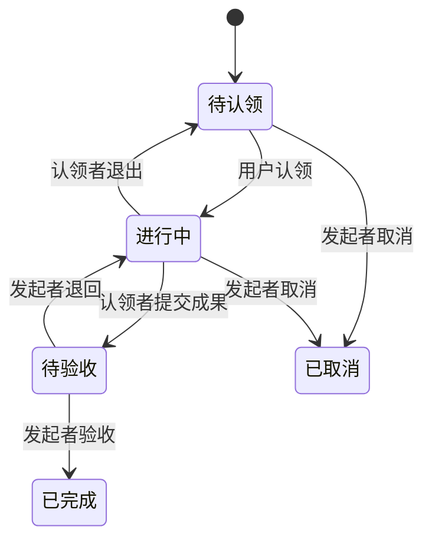

下面给出一个适用于**小型团队内部协作**的 MVP 方案：用户可以发布 Mission、认领未分配的 Mission，并将其拆成可独立认领的子 Mission。

核心原则是：**每个 Mission 都是完整的任务单元；父子关系表达拆分关系，每个节点分别保存内容、发起者、认领者和状态。**

**1. 数据模型**

Mission 可以采用以下结构：

| 字段 | 类型 | 含义 |
|---|---|---|
| `id` | UUID | 唯一标识 |
| `title` | string | 标题 |
| `content` | Markdown | 背景、目标、要求 |
| `acceptance_criteria` | Markdown | 验收标准 |
| `creator_id` | User ID | 发起者，创建后固定 |
| `assignee_id` | User ID / null | 唯一认领者 |
| `parent_id` | Mission ID / null | 父 Mission；为空表示顶层任务 |
| `status` | enum | 当前状态 |
| `result` | Markdown / null | 提交的成果说明、链接等 |
| `version` | integer | 用于检测并发修改 |
| `created_at` / `updated_at` | datetime | 创建、更新时间 |

标签单独保存，使用关联表连接 Mission：

```text
User
Mission
Tag
MissionTag(mission_id, tag_id)
MissionEvent(mission_id, actor_id, action, payload, created_at)
Comment(mission_id, author_id, content, created_at, updated_at)
LibraryFile(owner_id, file, original_name, content_type, size, created_at)
```

`MissionEvent` 记录认领、退出、修改目标、提交和验收等操作，形成活动记录。

`Comment` 是挂在 Mission 下的讨论内容：`content` 与 `Mission.content` 定义完全一致（Markdown 文本，允许为空，不设长度上限）。任何团队成员都可以在可见任务下发表评论，**任意状态都允许评论**（包括已完成、已取消）；只有作者本人可以编辑或删除自己的评论。评论列表按创建时间倒序返回。

`LibraryFile` 是某个用户的素材库文件。文件本体存放在持久化目录 `library/<user_id>/`（文件名使用随机 UUID，不采用上传时的名字，避免冲突与路径穿越），数据库保存归属、原始文件名、内容类型与大小：

| 字段 | 类型 | 含义 |
|---|---|---|
| `id` | UUID | 唯一标识，也是下载 URL 中的 id |
| `owner_id` | User ID | 文件所有者，文件按用户隔离存放 |
| `file` | File | 存储路径 `library/<owner_id>/<uuid><ext>` |
| `original_name` | string | 上传时的文件名，仅用于展示 |
| `content_type` | string | 由扩展名白名单推导，不信任客户端 |
| `size` | integer | 字节数 |
| `created_at` | datetime | 上传时间 |

素材的读取对所有登录成员开放（经授权下载，见第 7 节），但 **Markdown 只能引用作者自己的素材或外链 URL**。删除仅限所有者本人。

用户体系（`accounts.User`，继承 `AbstractUser`）保存团队成员，其中 `is_staff` 标记管理员（可访问管理后台）。**用户注册不直接创建用户**，而是先写入注册申请表：

| 字段 | 类型 | 含义 |
|---|---|---|
| `id` | UUID | 唯一标识 |
| `username` | string | 期望的登录名 |
| `email` | string | 邮箱，可空 |
| `display_name` | string | 姓名，可空；审批通过后写入用户 `first_name` |
| `password_hash` | string | 提交时立即哈希的密码，绝不保存明文 |
| `message` | Markdown | 申请人留言，可空 |
| `status` | enum | `Pending` / `Approved` / `Rejected` |
| `review_note` | string | 拒绝原因等审批意见，可空 |
| `reviewed_by` | User ID / null | 审批的管理员 |
| `reviewed_at` | datetime / null | 审批时间 |
| `created_at` | datetime | 提交时间 |

待审批的注册申请**不写入** `auth_user`：未通过的用户名不会被占用，也不会出现在成员列表中；只有管理员批准时才创建（激活）用户。同一用户名最多允许一条 `Pending` 申请（数据库唯一约束）。

**标签属于当前 Mission，不自动继承。** 查询时可以提供“包含匹配任务的所有子任务”选项，避免标签继承导致分类含义混乱。

多标签查询为 **AND** 语义：重复 `tag` 参数（`?tag=Unity&tag=Gameplay`）或逗号写法（`?tag=Unity,Gameplay`）都表示“任务需同时含有全部标签”，任一标签不匹配则结果为空。

**2. 生命周期**



对应枚举：

```csharp
Open, InProgress, Submitted, Done, Cancelled
```

状态与认领者之间有固定约束：

- `Open`：认领者为空。
- `InProgress`、`Submitted`、`Done`：认领者非空。
- `Cancelled`：保留取消时的认领者，便于追踪历史。

MVP 中允许用户认领自己发布的任务，并自行确认完成；如果以后需要独立审核，可以再加入审核者角色。

**3. 父子 Mission 的协作规则**

假设发布一个 Mission：

> **实现角色移动系统**  
> 标签：`Unity`、`Gameplay`  
> 发起者：Alice  
> 认领者：Bob

Bob 将其拆成：

| 子 Mission | 发起者 | 认领者 | 状态 |
|---|---|---|---|
| 实现行走与跳跃 | Bob | Carol | 进行中 |
| 实现 Dash | Bob | 暂无 | 待认领 |
| 编写移动系统测试 | Bob | Dave | 待验收 |

这里 Bob 负责父 Mission 的整体交付，Carol 和 Dave 分别负责具体工作。

建议采用这些规则：

- **认领父任务不会自动认领子任务**；认领子任务也不改变父任务的负责人。
- 父任务的发起者和认领者可以创建子任务；子任务的发起者是实际创建它的用户。
- 全部有效子任务完成后，父任务才允许提交，但**不会自动完成**。Bob 仍需整合成果并交给 Alice 验收。
- 子任务被取消时，必须记录原因；取消任务不阻止父任务提交，父任务发起者在验收时确认是否接受这项范围变化。
- 取消或退出父任务，不自动取消子任务，也不清除子任务的认领者。
- 每个 Mission 最多有一个父任务，禁止形成循环。

这样，任务树既能表达责任，也能保留各层独立的验收关系。

**4. 操作与权限**

| 操作 | 谁可以执行 |
|---|---|
| 发布 Mission | 团队成员 |
| 认领待认领任务 | 团队成员 |
| 编辑目标与验收标准 | 当前任务发起者 |
| 创建子 Mission | 当前任务发起者或认领者 |
| 更新成果说明、提交成果 | 当前任务认领者 |
| 退出认领 | 当前任务认领者；限进行中 |
| 验收或退回 | 当前任务发起者 |
| 取消 | 当前任务发起者；限待认领或进行中 |
| 提交注册申请 | 任何人，无需登录 |
| 审批注册申请（通过 / 拒绝） | 管理员（`is_staff`） |
| 查看成员列表 | 管理员（`is_staff`） |
| 发表评论 | 任何团队成员；限可见任务，任意状态 |
| 编辑 / 删除评论 | 评论作者本人 |
| 上传素材 | 团队成员；只能写入自己的 library |
| 查看 / 下载素材 | 任何登录成员（经授权下载） |
| 删除素材 | 素材所有者本人 |
| Markdown 引用素材 | 只能引用自己的素材或外链 URL |

任务进入待验收后，冻结目标和成果内容。需要修改时，先退回进行中；已完成任务保持只读。

所有规则由后端检查，前端根据权限显示按钮。注册申请与成员管理属于 `accounts` 域，普通成员访问 `/api/admin/*` 一律返回 `403`。

**5. 页面与接口**

登录后的首页提供三个入口：

- **任务广场**：默认显示待认领任务，支持多标签（需同时包含）、关键词和发起者筛选。
- **我认领的**：显示自己的进行中、待验收任务。
- **我发布的**：查看任务进展，并处理验收。
- **素材库（`/library`）**：上传、查看、复制 Markdown 引用、删除自己的文件。任务与评论编辑器提供「插入素材」按钮，可从素材库选择或直接上传，并把引用插入到光标处。
- **管理后台（`/manage`，仅管理员）**：审批注册申请、查看成员列表。由 SPA 自行实现，与 Django Admin（`/admin/`）相互独立。

未登录用户可访问 **注册页（`/register`）** 提交注册申请，等待管理员审批后方可登录。

详情页显示内容、验收标准、父子任务树、成果、讨论区与活动记录。操作按钮随状态变化，例如“认领”“退出”“提交成果”“验收通过”。

后端使用明确的操作接口，避免允许客户端任意修改状态：

| 接口 | 用途 |
|---|---|
| `POST /missions` | 发布任务 |
| `GET /missions` | 筛选、查询任务（多标签 AND：`?tag=a&tag=b`） |
| `PATCH /missions/{id}` | 编辑允许修改的内容 |
| `POST /missions/{id}/claim` | 认领 |
| `POST /missions/{id}/release` | 退出 |
| `POST /missions/{id}/submit` | 提交成果 |
| `POST /missions/{id}/review` | 通过或退回，附验收意见 |
| `POST /missions/{id}/cancel` | 取消 |
| `POST /api/auth/register` | 提交注册申请（公开，需 CSRF） |
| `GET /api/admin/registrations` | 管理员查看注册申请，可按 `status` 筛选 |
| `POST /api/admin/registrations/{id}/approve` | 管理员通过注册申请 |
| `POST /api/admin/registrations/{id}/reject` | 管理员拒绝注册申请，可附原因 |
| `GET /api/admin/users` | 管理员查看成员列表 |
| `GET /missions/{id}/comments` | 分页查看评论（最新在前） |
| `POST /missions/{id}/comments` | 发表评论 |
| `PATCH /comments/{id}` | 编辑自己的评论 |
| `DELETE /comments/{id}` | 删除自己的评论 |
| `POST /api/library/files` | 上传文件到自己的素材库（multipart） |
| `GET /api/library/files` | 分页查看自己的素材 |
| `GET /api/library/files/{id}` | 经授权下载素材（图片内联，其余附件下载） |
| `DELETE /api/library/files/{id}` | 删除自己的素材 |

**认领必须是原子操作。** 例如：

```sql
UPDATE missions
SET assignee_id = :user_id,
    status = 'InProgress',
    version = version + 1
WHERE id = :mission_id
  AND assignee_id IS NULL
  AND status = 'Open';
```

只有更新到一行时才算认领成功；否则返回 `409 Conflict`，提示任务已被认领或状态已变化。操作记录与任务更新应在同一个事务中写入。

**6. 用户注册与管理员审批**

自助注册采用「先申请、后审批」：

1. 未登录用户在 `/register` 提交用户名、密码（可选姓名、邮箱、申请说明）。
2. 后端校验用户名未被现有用户占用、没有重复的待审批申请、密码满足强度要求，然后写入一条 `Pending` 申请；密码在此刻就已哈希，明文不落库。
3. 管理员在 `/manage`（或 Django Admin 的「注册申请」列表）处理：**通过**则创建并激活用户，沿用申请中的用户名、邮箱、姓名与密码哈希；**拒绝**则记录原因，不创建任何用户。
4. 审批前该用户无法登录（凭证不存在，返回 `401`）；审批通过后即可用申请时的密码登录。

审批是状态转换，必须走 `accounts/services.py`（视图与 Django Admin 的 action 都调用它），不能通过直接编辑字段修改状态。并发审批同一申请使用行锁 + 状态校验，只有一个成功，其余返回 `409`（`code=registration_already_reviewed`）。

**7. 素材库与 Markdown 引用规则**

**存储与访问。** 上传的文件按用户隔离存放于 `library/<user_id>/`，是持久化目录而非公开静态目录（生产环境不把 `MEDIA_ROOT` 交给 Caddy）。下载统一走 `GET /api/library/files/{id}/`：任何登录成员都可读取（经授权下载），响应带 `X-Content-Type-Options: nosniff`；图片以 `inline` 返回以便 `` 内联显示，其余类型以 `attachment` 返回。删除只能由所有者本人发起。

**允许的类型与大小。** 白名单扩展名：`png`、`jpg`、`jpeg`、`gif`、`webp`、`pdf`、`zip`、`txt`、`md`；单文件上限 20 MB。内容类型由扩展名推导，不采用客户端声明的类型，避免伪装成 HTML/JS。

**引用规则（写入时校验）。** 所有 Markdown 字段（Mission 的 `content`、`acceptance_criteria`、提交的 `result`，以及评论 `content`）在写入时必须满足：每个链接/图片目标要么是 **作者自己的素材库链接**（`/api/library/files/<id>/`，且该文件属于作者），要么是 **外链 URL**（`http(s)://` 或协议相对 `//host/...`）。以下一律拒绝并返回 `400`（`code=validation_error`，`field_errors` 指向对应字段）：

- 其他成员的素材库链接，或不存在/非法 id 的素材链接；
- 任意站内路径（如 `/media/...`、`/api/missions/...`）与相对路径；
- `javascript:`、`data:`、`mailto:` 等非 http(s) 协议。

纯文档内锚点（`#section`）允许，因为它不引用任何资源；Markdown 语法与内联 HTML（如 ``、`srcset`）都会被检查，代码块与行内代码会被忽略，避免示例代码误报。校验在服务层完成（`library/references.py` + `missions/services.py`），因此 API 与 Admin 等所有写入口都受同一规则约束。

这个版本已经能跑通一次完整协作：**发布 → 发现 → 认领 → 拆分 → 执行 → 提交 → 验收**；并在此基础上增加了带管理员审批的用户自助注册、SPA 管理后台与按用户隔离的素材库。后续可根据实际使用增加依赖关系、多人参与和通知。
