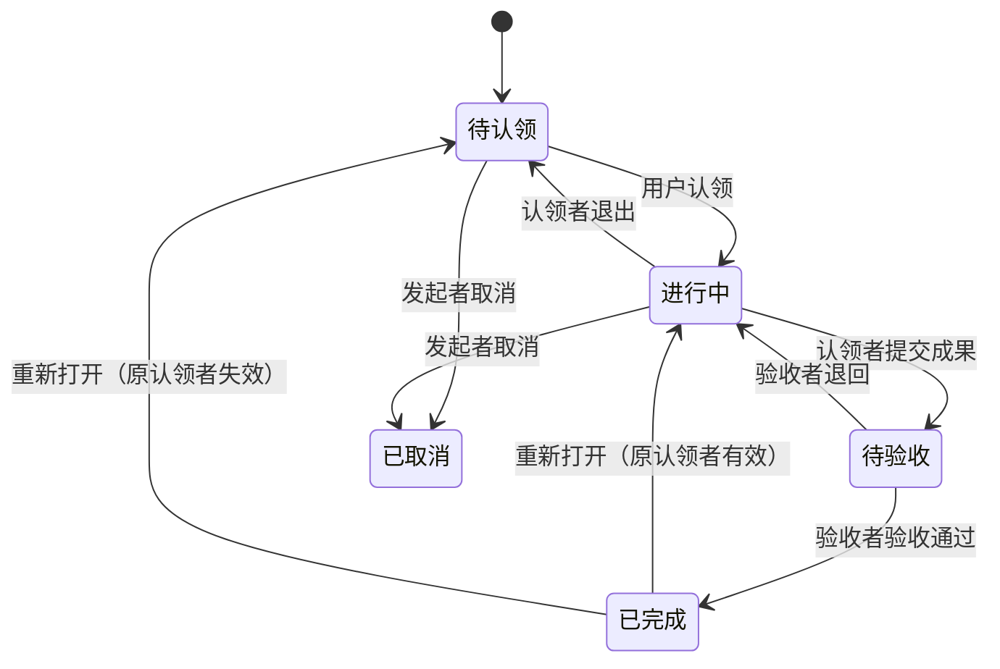

# PROJECT_STRUCTURE

本文面向开发者与维护 Agent，记录当前目录职责、数据模型、接口、权限、页面与业务规则。用户使用说明见 [README](README.md) 与 [TUTORIAL](TUTORIAL.md)；技术约束及开发、验证、部署命令见 [TECH_STACK](TECH_STACK.md)。

## 仓库目录与职责

```text
backend/              Django API
  config/             settings、URL、WSGI、统一异常处理
  common/             跨 app 共享的领域异常
  accounts/           认证、注册申请与管理员审批
  missions/           任务、设计资产、生产模板、里程碑、服务层与测试
  library/            用户素材、授权下载与 Markdown 引用校验
  notifications/      站内通知、任务订阅与日期提醒
  agent_bridge/       本地 Agent 设备、文本请求交接与结果协议
  transfers/          浏览器文件直传会话、信令与清理
frontend/src/         Vue SPA
  api/                类型化 API 客户端
  components/         共享组件
  composables/        组合式逻辑与甘特布局
  router/、stores/    页面路由与共享状态
  views/              页面
  transfers/          浏览器直传协议
  workspace/          工作台辅助逻辑
  tests/              前端测试
local_runner/         用户本机 OpenCode 适配器及测试
deploy/               Caddy、生产 Compose 与部署操作指南
.cursor/rules/        AGENTS 索引的项目规则
docker-compose.yml    本地 PostgreSQL
testrun.sh            本地环境启动脚本
```

业务写入通过对应服务层：Mission 流程走 `backend/missions/services.py`，注册审批走 `backend/accounts/services.py`，素材上传/删除走 `backend/library/services.py`。API 与 Django Admin 复用业务校验，不绕过状态机。其他模块的职责与接口见下方对应功能章节。

核心原则是：**每个 Mission 都是完整的任务单元；父子关系表达拆分关系，每个节点分别保存内容、发起者、认领者和状态。**

**1. 数据模型**

Mission 可以采用以下结构：

| 字段 | 类型 | 含义 |
|---|---|---|
| `id` | UUID | 唯一标识 |
| `title` | string | 标题 |
| `content` | Markdown | 背景、目标、要求 |
| `acceptance_criteria` | Markdown | 验收标准 |
| `creator_id` | User ID | 发起者，创建后固定 |
| `assignee_id` | User ID / null | 唯一认领者 |
| `reviewer_id` | User ID / null | 独立验收者；新建默认发起者 |
| `parent_id` | Mission ID / null | 父 Mission；为空表示顶层任务 |
| `type` | enum | `Feature` / `Task` / `Bug`，默认 `Task` |
| `priority` | enum | `P0` / `P1` / `P2` / `P3`，默认 `P2` |
| `milestone_id` | Milestone ID / null | 唯一目标里程碑（排期维度，非父任务） |
| `status` | enum | 当前状态 |
| `current_submission_id` | MissionSubmission ID / null | 当前一轮成果；历史轮次不可覆盖 |
| `version` | integer | 用于检测并发修改 |
| `created_at` / `updated_at` | datetime | 创建、更新时间 |

标签单独保存，使用关联表连接 Mission：

```text
User
Mission
Tag
MissionTag(mission_id, tag_id)
MissionDependency(mission_id, prerequisite_id, created_by_id, created_at)
Milestone(id, name, description, due_date, status, version, created_by_id, created_at, updated_at)
MissionSubmission(id, mission_id, submitted_by_id, submitted_at, description, verification_description, reviewer_id_snapshot, outcome, reviewed_by_id, reviewed_at, review_comment, verified_build_reference_id)
SubmissionSourceReference(id, submission_id, provider, repository, revision, browse_url)
SubmissionBuildReference(id, submission_id, provider, build_id, platform, source_revision, artifact_url, status, verification_note)
MissionEvent(mission_id, actor_id, action, payload, created_at)
MilestoneEvent(milestone_id, actor_id, action, payload, created_at)
Comment(mission_id, author_id, content, created_at, updated_at)
LibraryFile(owner_id, file, original_name, content_type, size, created_at)
```

`MissionEvent` 记录认领、退出、修改目标、提交、验收、依赖、转交与重新打开等操作；`MilestoneEvent` 记录里程碑的创建、修改与状态流转。所有事件与对应业务变更在同一事务内写入，包含实际操作者、动作、原因与必要前后值。

`MissionDependency` 表示「`mission` 依赖 `prerequisite`」：`prerequisite` 必须先完成，依赖它的 `mission` 才能提交与验收通过。唯一约束禁止重复 `(mission_id, prerequisite_id)` 与自依赖；依赖方向与父子关系是两种不同关系，分别建模（详见第 8 节）。

`Comment` 是挂在 Mission 下的讨论内容：`content` 与 `Mission.content` 定义完全一致（Markdown 文本，允许为空，不设长度上限）。任何团队成员都可以在可见任务下发表评论，**任意状态都允许评论**（包括已完成、已取消）；只有作者本人可以编辑或删除自己的评论。评论列表按创建时间倒序返回。

`LibraryFile` 是某个用户的素材库文件。文件本体存放在持久化目录 `library/<user_id>/`（文件名使用随机 UUID，不采用上传时的名字，避免冲突与路径穿越），数据库保存归属、原始文件名、内容类型与大小：

| 字段 | 类型 | 含义 |
|---|---|---|
| `id` | UUID | 唯一标识，也是下载 URL 中的 id |
| `owner_id` | User ID | 文件所有者，文件按用户隔离存放 |
| `file` | File | 存储路径 `library/<owner_id>/<uuid><ext>` |
| `original_name` | string | 上传时的文件名，仅用于展示 |
| `content_type` | string | 由扩展名白名单推导，不信任客户端 |
| `size` | integer | 字节数 |
| `created_at` | datetime | 上传时间 |

素材的读取对所有登录成员开放（经授权下载，见第 7 节），但 **Markdown 只能引用作者自己的素材或外链 URL**。删除仅限所有者本人。

用户体系（`accounts.User`，继承 `AbstractUser`）保存团队成员，其中 `is_staff` 标记管理员（可访问管理后台）。**用户注册不直接创建用户**，而是先写入注册申请表：

| 字段 | 类型 | 含义 |
|---|---|---|
| `id` | UUID | 唯一标识 |
| `username` | string | 期望的登录名 |
| `email` | string | 邮箱，可空 |
| `display_name` | string | 姓名，可空；审批通过后写入用户 `first_name` |
| `password_hash` | string | 提交时立即哈希的密码，绝不保存明文 |
| `message` | Markdown | 申请人留言，可空 |
| `status` | enum | `Pending` / `Approved` / `Rejected` |
| `review_note` | string | 拒绝原因等审批意见，可空 |
| `reviewed_by` | User ID / null | 审批的管理员 |
| `reviewed_at` | datetime / null | 审批时间 |
| `created_at` | datetime | 提交时间 |

待审批的注册申请**不写入** `auth_user`：未通过的用户名不会被占用，也不会出现在成员列表中；只有管理员批准时才创建（激活）用户。同一用户名最多允许一条 `Pending` 申请（数据库唯一约束）。

**标签属于当前 Mission，不自动继承。** 查询时可以提供“包含匹配任务的所有子任务”选项，避免标签继承导致分类含义混乱。

多标签查询为 **AND** 语义：重复 `tag` 参数（`?tag=Unity&tag=Gameplay`）或逗号写法（`?tag=Unity,Gameplay`）都表示“任务需同时含有全部标签”，任一标签不匹配则结果为空。

**2. 生命周期**



对应枚举：

```csharp
Open, InProgress, Submitted, Done, Cancelled
```

状态与认领者之间有固定约束：

- `Open`：认领者为空。
- `InProgress`、`Submitted`、`Done`：认领者非空。
- `Cancelled`：保留取消时的认领者，便于追踪历史。

验收由任务的 **验收者（`reviewer`）或管理员**执行，而不是固定为发起者；新建任务时验收者默认等于发起者，但可以指定为他人。默认仍允许认领者与验收者是同一个人，独立验收表示角色可以分开，不强制双人审核。

已完成任务可通过 `reopen` 动作重新打开（仅限 `Done`，必须填写原因）：原认领者仍是有效成员时恢复 `InProgress`，否则清空认领者恢复 `Open`；历史提交与验收记录全部保留，`current_submission_id` 清空。若存在已完成的祖先任务，必须先从最上层向下逐级重新打开祖先，不允许留下「父任务已完成、子任务进行中」的结构。

阻塞是**派生信息**，不新增 `Blocked` 状态：只要存在未完成的前置依赖，任务即显示为阻塞（见第 8 节）。

**3. 父子 Mission 的协作规则**

假设发布一个 Mission：

> **实现角色移动系统**  
> 标签：`Unity`、`Gameplay`  
> 发起者：Alice  
> 认领者：Bob

Bob 将其拆成：

| 子 Mission | 发起者 | 认领者 | 状态 |
|---|---|---|---|
| 实现行走与跳跃 | Bob | Carol | 进行中 |
| 实现 Dash | Bob | 暂无 | 待认领 |
| 编写移动系统测试 | Bob | Dave | 待验收 |

这里 Bob 负责父 Mission 的整体交付，Carol 和 Dave 分别负责具体工作。

建议采用这些规则：

- **认领父任务不会自动认领子任务**；认领子任务也不改变父任务的负责人。
- 父任务的发起者和认领者可以创建子任务；子任务的发起者是实际创建它的用户。
- 全部有效子任务完成后，父任务才允许提交，但**不会自动完成**。Bob 仍需整合成果并交给 Alice 验收。
- 子任务被取消时，必须记录原因；取消任务不阻止父任务提交，父任务发起者在验收时确认是否接受这项范围变化。
- 取消或退出父任务，不自动取消子任务，也不清除子任务的认领者。
- 每个 Mission 最多有一个父任务，禁止形成循环。

这样，任务树既能表达责任，也能保留各层独立的验收关系。

**4. 操作与权限**

| 操作 | 谁可以执行 |
|---|---|
| 发布 Mission | 团队成员 |
| 认领待认领任务 | 团队成员 |
| 编辑目标与验收标准 | 当前任务发起者或管理员 |
| 修改类型 / 优先级 / 验收者 / 目标里程碑 | 当前任务发起者或管理员；限 `Open` / `InProgress` |
| 创建子 Mission | 当前任务发起者或认领者 |
| 添加 / 移除前置依赖 | 当前任务发起者、当前认领者或管理员；限 `Open` / `InProgress` |
| 提交成果与证据 | 当前任务认领者 |
| 退出认领 | 当前任务认领者；限进行中 |
| 验收通过 / 退回 | 当前任务验收者或管理员 |
| 转交验收（仅待验收） | 当前任务发起者或管理员 |
| 重新打开已完成任务 | 当前任务发起者、当前验收者或管理员；仅限 `Done`，须填原因 |
| 取消 | 当前任务发起者或管理员；限待认领或进行中 |
| 创建里程碑 | 团队成员 |
| 编辑里程碑 / 变更里程碑状态 | 里程碑创建者或管理员 |
| 提交注册申请 | 任何人，无需登录 |
| 审批注册申请（通过 / 拒绝） | 管理员（`is_staff`） |
| 查看成员列表 | 管理员（`is_staff`） |
| 查看可验收成员（简要） | 任何团队成员（`GET /api/members/`，仅 id/username/display_name） |
| 发表评论 | 任何团队成员；限可见任务，任意状态 |
| 编辑 / 删除评论 | 评论作者本人 |
| 上传素材 | 团队成员；只能写入自己的 library |
| 查看 / 下载素材 | 任何登录成员（经授权下载） |
| 删除素材 | 素材所有者本人 |
| Markdown 引用素材 | 只能引用自己的素材或外链 URL |

任务进入待验收后，冻结目标和成果内容。需要修改时，先退回进行中；已完成任务保持只读。

所有规则由后端检查，前端根据权限显示按钮。注册申请与成员管理属于 `accounts` 域，普通成员访问 `/api/admin/*` 一律返回 `403`。

**5. 页面与接口**

登录后的首页提供三个入口：

- **任务广场**：默认显示待认领任务，支持多标签（需同时包含）、关键词、发起者、类型、优先级、里程碑与阻塞状态筛选，并支持按优先级排序。筛选项「受阻状态」与「排序方式」的下拉默认显示的是选项文本，鼠标悬停会显示用途说明（受阻判定规则、默认按最新创建在前）。
- **我认领的**：显示自己的进行中、待验收任务。
- **我发布的**：查看任务进展，并处理验收。
- **里程碑（`/milestones`）**：新建与筛选里程碑，查看进度、延期提示与关联任务；里程碑详情可编辑字段并做受控状态流转。
- **工作台（`/workspace`）**：把同一批任务按「里程碑 × 状态」概览和「甘特图」两种联动视图呈现，配合筛选、摘要与详情抽屉，快速回答「现在能做什么、被什么阻塞、每个里程碑的进展」（见第 9 节）。
- **素材库（`/library`）**：上传、查看、复制 Markdown 引用、删除自己的文件。任务与评论编辑器提供「插入素材」按钮，可从素材库选择或直接上传，并把引用插入到光标处。
- **管理后台（`/manage`，仅管理员）**：审批注册申请、查看成员列表。由 SPA 自行实现，与 Django Admin（`/admin/`）相互独立。

未登录用户可访问 **注册页（`/register`）** 提交注册申请，等待管理员审批后方可登录。

详情页显示内容、验收标准、任务树、前置依赖、下游任务、未完成子任务、成果与验收历史、讨论区与活动记录。操作按钮随状态变化，例如“认领”“退出”“提交成果”“验收”“转交验收”“重新打开”。所有针对现有对象的写操作在前端携带当前 `expected_version`，遇到 `409` 时提示并刷新数据，不乐观显示成功。

完整任务详情页须包含详情抽屉提供的全部任务操作；抽屉的定位和打开完整详情属于导航，不要求同名入口。两处均按 `allowed_actions` 显示“验收”和“退回”，仅当前验收者或管理员可用。退回必须填写意见，复用原验收接口，以 `decision=reject`、当前 `submission_id` 和 `expected_version` 提交；成功后恢复进行中并刷新成果与活动记录。失败构建不阻止退回。本规则不增加数据模型或接口。

后端使用明确的操作接口，避免允许客户端任意修改状态：

| 接口 | 用途 |
|---|---|
| `POST /missions` | 发布任务（支持 type / priority / reviewer_id / milestone_id） |
| `GET /missions` | 筛选、查询任务（多标签 AND：`?tag=a&tag=b`；新增 type / priority / milestone / blocked 筛选与 priority 排序） |
| `PATCH /missions/{id}` | 编辑允许修改的内容（携带 `expected_version`） |
| `POST /missions/{id}/claim` | 认领 |
| `POST /missions/{id}/release` | 退出 |
| `POST /missions/{id}/submit` | 提交成果（description、验证说明、源码与构建引用） |
| `POST /missions/{id}/review` | 验收通过或退回（`submission_id`、`decision`、`comment`、`verified_build_reference_id`） |
| `POST /missions/{id}/transfer-review` | 待验收时转交验收者 |
| `POST /missions/{id}/reopen` | 重新打开已完成任务（原因 + `expected_version`） |
| `POST /missions/{id}/cancel` | 取消 |
| `GET /missions/{id}/dependencies` | 查询直接前置与直接下游任务（前置项附带 `dependency_id` 以便移除） |
| `POST /missions/{id}/dependencies` | 添加前置依赖 |
| `DELETE /missions/{id}/dependencies/{dependency_id}` | 移除该任务的依赖（`?expected_version=`） |
| `GET /missions/{id}/submissions` | 分页查询各轮成果与证据 |
| `GET /milestones` / `POST /milestones` | 里程碑列表与创建 |
| `GET /milestones/{id}` / `PATCH /milestones/{id}` | 里程碑详情与普通字段编辑（`expected_version`） |
| `POST /milestones/{id}/transition` | 受控里程碑状态流转 |
| `POST /api/auth/register` | 提交注册申请（公开，需 CSRF） |
| `GET /api/members` | 已登录成员均可读取的有效成员列表（id / username / display_name），用于选择验收者 |
| `GET /api/admin/registrations` | 管理员查看注册申请，可按 `status` 筛选 |
| `POST /api/admin/registrations/{id}/approve` | 管理员通过注册申请 |
| `POST /api/admin/registrations/{id}/reject` | 管理员拒绝注册申请，可附原因 |
| `GET /api/admin/users` | 管理员查看成员列表 |
| `GET /missions/{id}/comments` | 分页查看评论（最新在前） |
| `POST /missions/{id}/comments` | 发表评论 |
| `PATCH /comments/{id}` | 编辑自己的评论 |
| `DELETE /comments/{id}` | 删除自己的评论 |
| `POST /api/library/files` | 上传文件到自己的素材库（multipart） |
| `GET /api/library/files` | 分页查看自己的素材 |
| `GET /api/library/files/{id}` | 经授权下载素材（图片内联，其余附件下载） |
| `DELETE /api/library/files/{id}` | 删除自己的素材 |
| `GET /api/workspace/overview` | 只读聚合：工作台「里程碑 × 状态」看板、页头摘要与数据修订标识（见第 9 节） |
| `GET /api/workspace/graph` | 只读聚合：工作台依赖图节点、有向边、截断原因与关系完整性（见第 9 节） |

**认领必须是原子操作。** 例如：

```sql
UPDATE missions
SET assignee_id = :user_id,
    status = 'InProgress',
    version = version + 1
WHERE id = :mission_id
  AND assignee_id IS NULL
  AND status = 'Open';
```

只有更新到一行时才算认领成功；否则返回 `409 Conflict`，提示任务已被认领或状态已变化。操作记录与任务更新应在同一个事务中写入。

**6. 用户注册与管理员审批**

自助注册采用「先申请、后审批」：

1. 未登录用户在 `/register` 提交用户名、密码（可选姓名、邮箱、申请说明）。
2. 后端校验用户名未被现有用户占用、没有重复的待审批申请、密码满足强度要求，然后写入一条 `Pending` 申请；密码在此刻就已哈希，明文不落库。
3. 管理员在 `/manage`（或 Django Admin 的「注册申请」列表）处理：**通过**则创建并激活用户，沿用申请中的用户名、邮箱、姓名与密码哈希；**拒绝**则记录原因，不创建任何用户。
4. 审批前该用户无法登录（凭证不存在，返回 `401`）；审批通过后即可用申请时的密码登录。

审批是状态转换，必须走 `accounts/services.py`（视图与 Django Admin 的 action 都调用它），不能通过直接编辑字段修改状态。并发审批同一申请使用行锁 + 状态校验，只有一个成功，其余返回 `409`（`code=registration_already_reviewed`）。

**7. 素材库与 Markdown 引用规则**

**存储与访问。** 上传的文件按用户隔离存放于 `library/<user_id>/`，是持久化目录而非公开静态目录（生产环境不把 `MEDIA_ROOT` 交给 Caddy）。下载统一走 `GET /api/library/files/{id}/`：任何登录成员都可读取（经授权下载），响应带 `X-Content-Type-Options: nosniff`；图片以 `inline` 返回以便 `` 内联显示，其余类型以 `attachment` 返回。删除只能由所有者本人发起。

**允许的类型与大小。** 白名单扩展名：`png`、`jpg`、`jpeg`、`gif`、`webp`、`pdf`、`zip`、`txt`、`md`；单文件上限 20 MB。内容类型由扩展名推导，不采用客户端声明的类型，避免伪装成 HTML/JS。

**引用规则（写入时校验）。** 所有 Markdown 字段（Mission 的 `content`、`acceptance_criteria`、每轮成果 `MissionSubmission.description`，以及评论 `content`）在写入时必须满足：每个链接/图片目标要么是 **作者自己的素材库链接**（`/api/library/files/<id>/`，且该文件属于作者），要么是 **外链 URL**（`http(s)://` 或协议相对 `//host/...`）。以下一律拒绝并返回 `400`（`code=validation_error`，`field_errors` 指向对应字段）：

- 其他成员的素材库链接，或不存在/非法 id 的素材链接；
- 任意站内路径（如 `/media/...`、`/api/missions/...`）与相对路径；
- `javascript:`、`data:`、`mailto:` 等非 http(s) 协议。

纯文档内锚点（`#section`）允许，因为它不引用任何资源；Markdown 语法与内联 HTML（如 ``、`srcset`）都会被检查，代码块与行内代码会被忽略，避免示例代码误报。校验在服务层完成（`library/references.py` + `missions/services.py`），因此 API 与 Admin 等所有写入口都受同一规则约束。

**8. 扩展：类型、依赖与阻塞、优先级与里程碑、独立验收与重新打开、提交与构建引用**

本节记录在基础 MVP 之上新增的四组能力。它们复用同一 `Mission` 模型、认领与状态机，全部业务写入集中在 `missions/services.py`。

**8.1 类型（F1）**

`Mission.type` 为固定枚举 `Feature` / `Task` / `Bug`，默认 `Task`；三种类型复用同一模型、认领与状态机，不限制父子组合，也不影响「是否完成」的判断。发起者或管理员可在 `Open` / `InProgress` 修改类型并记录 `type_changed` 事件；类型不能只通过标签表达。

**8.2 依赖与派生阻塞（F1）**

`MissionDependency(mission_id, prerequisite_id)` 表示 `mission` 依赖 `prerequisite`，即 `prerequisite` 必须先完成。约束：

- 唯一约束禁止重复 `(mission_id, prerequisite_id)`，并禁止自依赖（数据库 CheckConstraint）。
- 依赖可跨父任务；只能引用同一团队内、操作者可见的任务（本系统所有登录成员可见全部任务）。
- **必须同时检查依赖边与父子边的组合环**：完成顺序图中，子任务默认先于父任务完成，因此隐含 `child -> parent` 边，显式依赖为 `prerequisite -> dependent` 边。新增依赖、调整父节点都在这张合并图上做可达性检查；仅检查依赖表不足以防止死锁。例如「子任务依赖祖先任务」会被拒绝。
- 发起者、当前认领者或管理员可在 `Open` / `InProgress` 添加/移除依赖；`Submitted` / `Done` / `Cancelled` 不允许直接修改依赖，需先退回可编辑状态。

阻塞是派生信息，不新增状态、不维护手工同步字段。API 返回：

| 字段 | 含义 |
|---|---|
| `has_unresolved_prerequisites` | 任一直接前置任务不是 `Done` |
| `is_blocked` | 状态为 `Open` / `InProgress` / `Submitted` 且存在未完成前置任务 |
| `blocking_mission_ids` | 未完成前置任务 ID |
| `unfinished_child_ids` | 尚未完成的有效直接子任务 ID（与依赖阻塞分开表示） |
| `needs_dependency_review` | 已 `Done` 但前置任务不再满足，提示需复核 |

- 前置任务仅在 `Done` 时满足依赖；`Cancelled` 仍阻塞，需显式移除依赖或改前置。
- 父任务的有效子任务排除 `Cancelled` 子任务。
- 阻塞任务仍可认领；提交与验收通过都必须同时检查所有直接前置任务为 `Done` 且所有有效直接子任务为 `Done`，因此阻塞期间禁止提交与验收通过。
- 前置任务重新打开后，下游未完成任务自动显示阻塞；下游已 `Done` 不自动重开，只显示复核提示。不实现递归自动推进。

**8.3 优先级（F2）**

`Mission.priority` 为固定枚举 `P0` / `P1` / `P2` / `P3`，默认 `P2`；`P0` 最紧急。发起者或管理员可在 `Open` / `InProgress` 修改，认领者只能在评论中建议。优先级不代表状态、依赖或截止日期，不触发自动抢占。列表支持按 priority 筛选与排序，相同优先级按创建时间与 ID 稳定排序。

**8.4 里程碑（F2）**

`Milestone` 是排期维度，不是父任务，也不是游戏构建版本：

| 字段 | 含义 |
|---|---|
| `id` | 主键 |
| `name` | 名称 |
| `description` | 交付目标 |
| `due_date` | 可空目标日期（按 `settings.TIME_ZONE` 解释） |
| `status` | `Planned` / `Active` / `Completed` / `Cancelled`，默认 `Planned` |
| `version` | 乐观并发版本号 |
| `created_by_id` | 创建者 |
| `created_at` / `updated_at` | 时间戳 |

- 团队成员可创建；创建者或管理员可编辑字段、变更状态；变更记录 `MilestoneEvent`。
- 受控流转：`Planned -> Active`、`Planned/Active -> Cancelled`、`Active -> Completed`、`Completed/Cancelled -> Active`（恢复需记录原因）。
- 只有 `Planned` / `Active` 的里程碑可接收新的或重新分配的任务（`milestone_not_accepting`）。
- 完成条件：至少一个**有效**（非 `Cancelled`）关联任务，且关联任务全部为 `Done` 或 `Cancelled`；必须由创建者或管理员手动确认，不自动完成。仅含已取消任务或没有任务的里程碑不能完成。
- 不硬删除有任务关联的里程碑，用 `Cancelled` 保留历史。
- 进度 = 直接关联且非 `Cancelled` 的 Mission 中 `Done` 数量 / 有效总数；没有有效任务时为 `null`。`overdue` = 已过目标日期且状态为 `Planned` / `Active`。
- 父子任务分别关联时按不同任务计数；这是任务数比例，不表示工时。
- 已 `Completed` 里程碑中的任务要重新打开时，需先把里程碑恢复为 `Active`；`Cancelled` 同理。

**8.5 独立验收者与成果历史（F3）**

- `Mission.reviewer_id`：新建任务默认发起者；必须是团队有效成员。发起者或管理员可在 `Open` / `InProgress` 修改（记录 `reviewer_changed`）；`Submitted` 状态可通过专用「转交验收」动作修改并记录原因（`review_transferred`），但不得用普通 `PATCH` 修改。
- 验收通过 / 退回只能由当前验收者或管理员执行；发起者只有在同时是验收者或管理员时才能验收。默认允许 `assignee == reviewer`。
- 验收者失效或离开团队（`is_active=False`）时，任务显示 `reviewer_missing`，需重新指定；新增提交必须具有有效验收者（否则 `reviewer_missing`）。
- `MissionSubmission` 记录每一轮成果，永不覆盖旧记录：

| 字段 | 含义 |
|---|---|
| `mission_id` / `submitted_by_id` / `submitted_at` | 所属任务、提交者与时间 |
| `description` | 本轮成果与验证说明（Markdown） |
| `verification_description` | 人工验证步骤与结果；无源码/构建引用时必填 |
| `reviewer_snapshot_id` | 提交时的验收者，仅作历史 |
| `outcome` | `Pending` / `Accepted` / `Rejected` |
| `reviewed_by_id` / `reviewed_at` | 实际验收者与时间（可空） |
| `review_comment` | 验收意见；退回时必填 |
| `verified_build_reference_id` | 验收通过时选定的构建引用 |

- 提交者只能是当前认领者；提交后描述与证据冻结，退回后重新提交产生新记录。
- 验收请求必须针对**当前 Pending 提交**（携带 `submission_id`），过期或不属于当前提交返回 `409`（`submission_conflict`）。
- 提交术语固定为 `description`（不再接受旧字段 `result` 作为别名）；验收决定只接受 `accept` / `reject`。

**8.6 重新打开（F3）**

- 仅限 `Done`；`Cancelled` 不通过 reopen 恢复。发起者、当前验收者或管理员可执行，必须提供非空原因。
- 原认领者仍是有效成员时恢复 `InProgress`；失效时清空认领者恢复 `Open`。
- 保留全部历史提交与验收；清空 `current_submission_id`，后续提交创建新记录；保留 `reviewer`（失效时提示重新指定）。
- 祖先任务已 `Done` 时必须先从上到下逐级重开祖先（`ancestor_done`）；目标里程碑已关闭时必须先恢复里程碑（`milestone_closed`）。
- 不自动重开依赖它的其他任务，按 8.2 展示阻塞或复核提示。失败时不部分改变任务或历史。

**8.7 提交与游戏构建引用（F4）**

`MissionSubmission` 下挂不可变的两类证据，一轮成果可引用多条：

| 对象 | 字段 |
|---|---|
| `SubmissionSourceReference` | id、submission_id、provider（Git / Perforce / UVCS / Other）、repository、revision、browse_url（可空） |
| `SubmissionBuildReference` | id、submission_id、provider、build_id、platform、source_revision（可空）、artifact_url（可空）、status（Unknown / Pending / Succeeded / Failed）、verification_note（可空） |

规则：

- `repository` 与 `revision` 不能为空；`build_id` 与 `platform` 必填。
- `submit` 在同一事务内保存证据并进入 `Submitted`。证据必须满足之一：至少一个源码引用、至少一个构建引用、或清楚的人工验证说明。
- 验收通过时，若附带构建，至少一个构建必须为 `Succeeded`，且验收者须选择所验证的构建（`verified_build_reference_id`），该构建必须属于当前提交；只有失败/等待/未知构建时禁止通过。无构建时该字段为空，验收意见须说明人工验证方式。
- 构建 `status` 表示构建结果，不代表 QA 验收；构建成功不会自动把任务设为 `Done`。
- URL 仅允许 `http(s)`，拒绝带访问凭据的链接；后端不自动访问用户填写的 URL。

**8.8 事务、并发与版本**

- 所有写接口强制要求 `expected_version`（创建对象除外，由服务端初始化版本）：现有动作接口 `claim` / `release` / `submit` / `review` / `transfer-review` / `reopen` / `cancel` / `PATCH`，以及依赖增删、里程碑编辑与流转都校验版本；过期返回 `409`（`version_conflict`）。**这是相对旧接口的破坏性变更**，旧客户端必须携带 `expected_version`；SPA 已同步适配并在冲突时刷新数据。评论没有版本字段，沿用作者权限校验。
- 图结构变更与可能改变完成约束的状态操作统一使用固定键的 PostgreSQL 事务级 advisory lock（单团队一把团队级锁），在读取约束与写入之前获取；只读查询不取锁，锁内不做外部网络请求。提交、验收、依赖、里程碑完成、改里程碑与重新打开的操作相互串行，避免「检查后集合发生变化」。
- Mission 字段、依赖、提交、验收、转交、重新打开均递增所属 Mission 的 `version`；里程碑字段与状态变更递增其 `version`。版本检查与递增同业务写入原子执行。

**8.9 迁移与数据**

- 迁移新增 `type=Task`、`priority=P2`、`reviewer=creator`、`milestone=null`，为任务补充默认值。
- 不保留任何旧版兼容层：`Mission.result` 字段与 `MissionSubmission.is_legacy` 已移除，也不再提供旧数据回填；`submit` 不接受 `result` 别名，`review` 不接受 `approve` 旧决定名。
- 当前进度任务使用 `current_submission_id` 指向最新一轮提交；历史轮次以 `MissionSubmission` 记录，永不覆盖。
- `python manage.py seed_demo` 通过服务层创建样板数据，用于本地开发与演示；`--reset` 的删除范围、引用保护与账号保留规则见下文“本地演示场景”，操作命令见 `TECH_STACK.md` 第 15 节。

**8.10 前端**

四组功能的前端已适配：任务创建/编辑表单包含类型、优先级、验收者与目标里程碑；列表展示类型/优先级/受阻标识与里程碑，并支持 type / priority / milestone / blocked 筛选与优先级排序；详情页将任务树、前置依赖、下游任务、未完成子任务分开展示，并处理阻塞原因、依赖复核与验收者失效提示；提供成果提交（含源码/构建引用）、按轮次的成果与验收历史、验收构建选择、转交验收与重新打开原因输入；新增里程碑列表与详情页（进度、延期、关联任务、受控流转）；所有写操作携带 `expected_version`，遇到 `409` 刷新数据。前端路由新增 `/milestones` 与 `/milestones/:id`，导航新增「里程碑」。

前端验证命令（`frontend/`）：`npm run type-check`、`npm run test`、`npm run build`。

**9. 扩展：F5 可视化工作台**

本节是 F1—F4 之上的只读聚合层，用于把已有的类型、依赖阻塞、优先级、里程碑、验收等数据同时用「里程碑 × 状态」和「甘特图」两种视图表达。它**不新增业务状态、不新增写接口**，所有写入仍走 `missions/services.py`。

**9.1 页面与两种视图**

工作台页面为 `/workspace`（导航「工作台」，路由名 `workspace`），默认显示甘特图，可切换到里程碑概览；显式 `view=overview` 链接仍打开概览，视图切换写入 URL，刷新后保留选择：

- **概览（视图 A）**：按里程碑分组，每组五个状态列（待认领 / 进行中 / 待验收 / 已完成 / 已取消）。里程碑组默认按 `Active`、`Planned`、`Completed`、`Cancelled` 排序，同状态按目标日期（空日期在后）、再按 ID。**未归属里程碑**单独成组，不默认省略。组头显示名称、里程碑状态、目标日期、延期标识与「里程碑总计 有效完成/有效总数」（进度沿用 8.4：`Cancelled` 不计入分母，无有效任务显示「暂无有效任务」而非 100%）。
- **甘特图（视图 B，保留 `view=graph`）**：Vue Flow 绘制任务条与依赖线，`useGanttLayout.ts` 将真实日期映射到横轴，每个任务独占一行。日/周两档，显示今天和里程碑目标日期；单端日期明确缺失端点，不推算时长；双空任务放在未排期区域。超出窗口的上下文任务裁剪并标注延伸，原日期不变。
- 依赖仍为前置 → 下游，连线连接结束端，表达下游完成不得早于前置；缺结束日期时只表达业务关系。源 Mission 的稳定散列决定线色，前置 Done 为实线，否则虚线；里程碑决定卡片色，两套颜色语义独立。折叠后的合并边按可见源端着色，全部原边满足才显示满足，内部边隐藏。
- 父子分组默认开启，通过标签缩进与折叠控件表达层级，不占用日期横轴。折叠隐藏子树并合并关系，代表父任务日期不表示隐藏子任务排期，页面明确提示；合并环仍提示。保留选择、上下游聚焦、平移、缩放、适应视图、定位与原详情抽屉。禁止拖线、重接、节点拖动、删除快捷键和画布写入。关系列表及可键盘打开详情的任务日期列表提供等效信息。

**9.2 数据契约（只读）**

| 接口 | 参数 | 说明 |
|---|---|---|
| `GET /api/workspace/overview/` | `q`/`search`、`milestone`（uuid 或 `none`）、`status`、`type`、`priority`、`assignee`（`me`/`none`/uuid）、`reviewer`、`blocked`、`revalidation`、`tag`（可重复，AND）、`column_limit`（默认 20，上限 100） | 返回 `summary`（匹配总数、有效完成数、受阻数、待验收数、需复核数）、`groups`（每组含 `milestone` 摘要、`full_counts`、`matched_counts`、`columns`、`loaded`，并用 `full_counts_scope`/`matched_counts_scope` 明确统计范围）、`columns`/`column_labels` 与 `revision` |
| `GET /api/workspace/graph/` | 同上，另加 `scope`（`team`/`milestone`/`mission`）、`focus`（任务 id）、`expand`（`none`/`one`/`all`）、`direction`（`upstream`/`downstream`/`both`）、`depth`（1–5）、`context`、`include_parent`（父子分组默认开启，前端据此请求 `parent_edges` 驱动层级缩进与折叠） | 返回 `nodes`（含派生信息与 `is_context`）、`edges`（`is_satisfied`、`cross_milestone`）、可选 `parent_edges`（驱动父子层级与折叠）、`revision` 与 `meta`（计数、上限、`nodes_truncated`/`context_truncated`/`edges_truncated`、`truncation_reasons`、`relationships_complete`） |

- 节点字段与 `/api/missions/` 派生字段一致：`is_blocked`、`has_unresolved_prerequisites`、`requires_revalidation`（= `Done` 且前置不再满足，即 8.2 的复核提示）、`blocking_count`、`unfinished_child_count`、`reviewer_missing`、`milestone_closed`、`allowed_actions`，另含 `type`/`priority`/`status`/`assignee`/`reviewer`/`parent_id`/`milestone_id`/`version`。
- 只有**匹配筛选的任务**计入页头摘要；被筛选排除但直接相连的可见任务作为**一跳上下文节点**保留（`is_context=true`，虚线卡片），避免让任务看起来没有前置依赖。里程碑组头的「里程碑总计」统计该组**全部可见任务**，与「当前筛选」计数分别标注，不混为同一数字。
- 图最多返回 200 个节点（含上下文，`GRAPH_CONTEXT_LIMIT` 50）与 1000 条边；达到上限时返回 `truncated`、`truncation_reasons` 与 `relationships_complete=false`，而不是静默删边，前端据此显示「关系不完整」提示。
- `revision` 是由任务 `id/version/status/updated_at` 与可见依赖边计算出的**稳定数据修订标识**（同一批行返回同一值，写入后变化），用于判断是否需要整体刷新；它不是每次请求都变化的随机 `snapshot_id`，也不是可写版本号。
- 非法参数（未知 `status`/`type`/`priority`、非整数 `column_limit`、非 UUID 的 `milestone`/`focus`）返回 `400`（`validation_error`）；未登录返回 `403`。本系统所有登录成员可见全部任务，因此无受限节点泄露问题。

**9.3 前端与查询参数**

- 筛选栏：搜索、里程碑、状态、认领者、类型、优先级、受阻，以及快捷项「只看我的」（`assignee=me`）、「只看阻塞」（`blocked=true`）、「待我验收」（`reviewer=me` + `status=Submitted`）；另设「需复核」摘要计数。关键词输入**防抖 300ms**后才发起请求，且**新请求取代旧请求**（旧的慢响应不会覆盖新筛选）。视图、筛选与选中任务写入 URL（`view`、`q`、`milestone`、`status`、`assignee`、`reviewer`、`blocked`、`selected`、`limit`、`related`、`relations`、`parent`、`expand`、`direction`），链接可复现视图但不能绕过权限。
- 详情抽屉点击卡片打开，分别展示内容、**前置依赖 / 下游任务 / 父子关系**三类关系、成果与验收历史；抽屉内可执行认领、退出、验收/退回、转交验收、重新打开、取消、增删依赖等受控操作（携带 `expected_version`，冲突时提示并刷新），并可跳转完整详情页。
- 概览卡片显示 ID、标题、类型、优先级、状态文本、认领者、里程碑，并**分别**展示「前置未完成」与「子任务未完成」数量（不合并为同一计数）；颜色始终配合文本标签。卡片「查看依赖」切换到依赖图并以该任务为焦点。
- 依赖图默认高亮选中任务的直接前置与直接下游，「全部上游」「全部下游」是显式操作，「只看相关」保留「返回完整范围」入口；点击边显示源任务、目标任务与满足情况（含源任务标题与源色示意，文字区分「已满足／尚未满足」）。前端仅在**已加载的图**上做展示层遍历，关系是否完整以 `meta.relationships_complete` 为准；某条依赖的端点未加载时不算作分层约束，也不会被当作「没有依赖」。关闭详情抽屉（关闭按钮、Esc、遮罩，或因任务不存在而发出的 `close`）会清除当前 Mission 焦点：`selectedId`、选中依赖边、上下游摘要与 URL `selected` 一并清空，选中高亮与淡化消失；若此前开启「只看相关」，则同时退出该模式并重新获取团队范围的图，避免清除焦点后仍停留在按旧任务裁剪的图上。筛选、视图模式、父子显示／折叠状态与画布视口在关闭过程中保持不变；关闭引发的刷新带请求代次，旧请求不会把旧焦点或旧范围写回。从详情中「定位」另一 Mission 是程序化关闭，会保留新焦点、不会在随后被清掉。
- 「显示父子任务关系」默认开启：子任务按层级缩进标签并各占一行，父任务卡片可折叠/展开子任务；折叠后子任务从画布移除，其依赖关系合并到父任务（并标注「已折叠 N 个子任务」），布局按当前可见卡片与边重算，「关系列表」与里程碑图例随之只描述当前可见视图。折叠合并若产生依赖环，页面显示「依赖关系存在环」提示、只按可用层级展示，关系列表与其余交互保持可用。
- 页面可见时每 30 秒刷新一次，切到后台暂停；重新可见、窗口获得焦点、手动刷新与操作后均刷新。
- 前端不自行推断阻塞或权限：`is_blocked`、`allowed_actions` 等均来自后端。

**9.4 实现说明**

- 依赖图由 **Vue Flow** 渲染；坐标由 `frontend/src/composables/useGanttLayout.ts` 按日期与任务行计算，不引入第三方图布局引擎，也不做节点坐标持久化。
- 前端按职责拆分：页面 `frontend/src/views/WorkspaceView.vue`（视图切换、URL 状态、请求代次、父子分组与折叠状态、依赖环提示、详情关闭时清除焦点）、`WorkspaceFilterBar.vue`（筛选与防抖）、`MilestoneBoard.vue`/`MilestoneGroup.vue`（看板）、`WorkspaceMissionCard.vue`/`MissionGraphNode.vue`（卡片、图节点结束端 Handle 与子任务折叠控件）、`DependencyGraph.vue`（Vue Flow 画布与事件）、`MissionDetailDrawer.vue`（详情与受控操作）；`frontend/src/composables/useGanttLayout.ts`（日期坐标、窗口裁剪与逐行布局）、`GanttAxis.vue`（日期轴与目标标记）；`useGraphLayout.ts` 的依赖分层函数仍用于无父子分组时的行排序与环检查、`frontend/src/workspace/dto.ts`（DTO 适配与图节点/边契约，按可见源端着色并写入选中的高亮/淡化标记）、`frontend/src/workspace/edgeColor.ts`（按源 Mission `id` 稳定取得依赖线色与无源端回退色）、`frontend/src/workspace/milestoneColor.ts`（按里程碑 `id` 稳定取得卡片色，语义与线色独立）、`frontend/src/workspace/parentGrouping.ts`（父子森林、可见性、折叠合并与依赖重指向）、`frontend/src/workspace/dependencyTraversal.ts`（已加载图的展示层上下游遍历）、`frontend/src/workspace/filters.ts`（筛选契约）。
- 结构、日期、缩放档位或范围变化时重新计算坐标；单纯状态刷新只更新样式，保留当前视口与选中任务，避免整张图跳动。布局同步派生自已应用的响应，配合请求代次，旧筛选的结果不会覆盖新图。
- 后端聚合位于 `frontend/src/api/workspace.ts` 对应的 `backend/missions/workspace.py`，与服务层共用同一套 `derived_state_bulk` 与共享筛选（`backend/missions/filters.py`），避免列表与工作台的筛选逻辑分叉。
- 不实现自动排程、关键路径、工时预测、实时协同画布或保存节点坐标。

**10. 设计条目与 Mission 关联**

`DesignElement` 保存 UUID、title（1–200 字符）、content（Markdown）、kind（Design/Asset，创建后固定）、parent（可空、自引用 PROTECT）、created_by、version、archived、created_at/updated_at。设计与资产是同级对象，复用条目存储和接口，kind 创建后固定；parent 只能指向同类型条目，分别组织设计与资产层级，禁止跨类型父子关系。Design 的 `assets` 是指向 Asset 的非对称多对多引用，反向为 `referencing_designs`；同一资产可供多个设计复用。Asset 表示角色/关卡等交付对象，不是 LibraryFile。Mission 的可空 `design_element`（PROTECT）只接受 Design，最多一个主要设计依据；另以 `assets` 多对多关联相关资产。任务可同时引用两者，也可只关联其中一种或都为空；资产不必属于所选设计的引用集合，不自动同步引用。子任务在服务端不自动继承；创建表单可预填父任务的设计与资产并允许清空。

设计和资产各自拥有独立的父子树与有向依赖图。`DesignElementDependency` 保存 element/prerequisite；数据库约束禁止自依赖和重复边。`DesignElement.prerequisites` 通过该表指向同类型前置，反向 `dependents` 只读。创建/PATCH 接受 `prerequisite_ids` UUID 数组（完整替换，空数组清空，省略不变），响应包含 prerequisites/dependents 摘要。只能由当前条目创建者或管理员维护，沿用团队事务锁、expected_version、归档冻结和事件记录；新增依赖禁止归档目标，已存在的归档前置可保留或解除。禁止跨类型依赖、自依赖与直接/间接环（409 design_dependency_cycle）；父子树和依赖图分别验环，父子关系不隐含依赖。依赖变化记录 dependencies_changed 及 updated 前后值。依赖不触发归档级联，不生成或修改 Mission 依赖、状态与进度。跨类型关系仅为 Design → Asset 单向多对多引用，资产页的 referencing_designs 是只读反查，不是反向引用写入口。

有效成员可读取和创建；创建者或管理员可修改、移动和归档/恢复。所有写入走 missions/services.py，并记录 DesignElementEvent（element/actor/action/payload/created_at）。树变更先取现有团队事务锁，再行锁及 expected_version 校验，禁止自引用与循环。归档不级联，要求没有未归档直接子条目；恢复要求父节点未归档，归档内容须先恢复再编辑。禁止硬删除。Markdown 素材归属按条目创建者校验，管理员代编辑也不能引用管理员自己的私人素材替代作者素材。

Mission 创建与 PATCH 接受 `design_element_id`（null 解除）及 `asset_ids`（UUID 数组，完整替换，空数组解除，省略不变），返回 design_element 摘要及 assets 摘要数组（id/title/kind/archived）。关联修改遵守原任务编辑权限和 Open/InProgress 状态，记录 design_element_changed / assets_changed 事件并递增任务版本。新关联禁止指向归档条目；既有关联保留，提交原有归档资产引用也允许，解除后不能重新添加。设计引用和任务引用相互独立，归档不级联到引用方。设计内容变更不覆盖 Mission 内容、验收标准或成果，不自动重开任务。

接口：GET/POST `/api/design-elements/`，GET/PATCH `/api/design-elements/{id}/`，GET `/api/design-elements/{id}/events/`。列表和事件分页；列表支持 q、kind、parent（UUID/root）、archived（false 默认/true/all），详情含祖先路径、父节点、assets、referencing_designs、allowed_actions、has_children 和直属任务进度。设计创建/PATCH 接受 asset_ids 完整替换引用，只有设计创建者或管理员可维护，资产不能引用资产；引用修改与版本及事件同事务保存。PATCH 必须 expected_version，过期 409；kind 等未知输入拒绝。Mission 列表、工作台概览/依赖图共享 design_element（UUID/none）筛选，匹配任务的直接设计依据或直接相关资产，none 表示两者都为空，不递归到设计后代，也不经设计引用间接扩展到资产任务。

`/design` 与 `/design/:id` 的「设计与资产」页面分别提供设计树与资产树、懒加载分页、搜索/类型/归档筛选、Markdown 正文、编辑、归档、祖先跳转、直属任务、分页活动与进度。进度为非 Cancelled 直属 Mission 的 Done/有效数，零分母显示「暂无有效任务」，另列受阻/需复核数；父子 Mission 独立计数，不代表工时或资产验收状态。设计页发布入口预填设计依据，资产页发布入口预填相关资产；两种条目编辑均提供同类型父条目和前置依赖多选，详情卡片展示前置及依赖它的条目。设计编辑提供资产多选，详情展示引用资产，资产详情展示引用它的设计，所有引用沿用通用链接样式。任务表单分别选择设计与资产，详情和抽屉可回到两类条目；任务仍用原抽屉与生命周期操作。编辑版本冲突刷新版本并保留输入，不静默覆盖。

对应迁移为 `0005_alter_missionevent_action_designelement_and_more.py` 和 `0009_designelement_assets_mission_assets_and_more.py`，后者将既有跨类型父子关系转换为设计引用资产、将旧任务的资产依据移入相关资产；测试入口为 `test_design_elements.py` 与 `frontend/src/tests/designElements.spec.ts`，并保留原任务和工作台回归。

设计/资产独立依赖迁移：`0010_designelementdependency_designelement_prerequisites_and_more.py`；规则与并发测试：`backend/missions/tests/test_design_dependencies.py`。

**11. 资产生产模板与批次**

`ProductionTemplate` 保存 UUID、name、纯文本 description、steps JSON、created_by、version、archived 与时间戳；`ProductionTemplateEvent` 保存创建、修改、归档/恢复的操作者与前后值。有效成员可创建/读取，创建者或管理员可编辑/归档/恢复，归档后须先恢复再编辑，所有更新校验 expected_version，不提供硬删除。steps 为 1–30 个有序步骤，每步包含唯一 key（1–50 位字母数字下划线）、title、content、acceptance_criteria、type、priority、tags、prerequisite_keys。展示顺序不隐含依赖；允许并行与汇合，禁止未知字段、非法枚举、未知前置、重复边、自依赖与循环。Markdown 复用现有引用解析，仅允许 http(s) 外链和文内锚点，代码示例不视作引用；私人素材（含绝对 URL 的素材 API 路径）禁止进入可跨作者复用的模板。

`ProductionBatch` 是不可变的实例化记录：asset（DesignElement，一对一）、template（PROTECT）、template_version、template_snapshot（模板名与完整步骤）、created_by、created_at。`ProductionBatchItem` 保存 batch/step_key/mission，批次内步骤 key 唯一、每个 Mission 只属于一个生产步骤。每项 Asset 最多一个批次，后续工作通过普通发布入口增加，不提供重置或再次生成。

仅资产创建者或管理员可生成；资产与模板须未归档、资产 kind 必须 Asset，可选里程碑须 Planned/Active。操作携带资产 expected_version 和 template_version，在团队事务锁及资产/模板行锁下校验，整个批次、Mission、依赖、映射、事件一次提交；失败全部回滚。重复请求返回 `409 production_already_generated`，版本冲突 `409 version_conflict`。生成 Mission 标题为“资产标题 · 步骤标题”（拼接超过 200 字符拒绝），creator/reviewer 为操作者、assignee=null、status=Open、parent=null，关联资产，可统一指定里程碑；字段来自模板快照，依赖通过原 add_dependency 服务建立，不按步骤数组顺序推断。资产版本递增，模板版本不变。

生成任务继续使用原认领、提交、验收、拆分、取消与重新打开；取消前置不会自动解除下游依赖，完成步骤不会自动完成里程碑。生成后模板修改不回写任务，任务编辑也不回写快照。批次任务的 assets 必须保留批次所属资产（否则 `409 production_asset_locked`），可新增其他相关资产并独立设置设计依据。其他手工任务仍可正常改绑。

接口：GET/POST `/api/production-templates/`，GET/PATCH `/api/production-templates/{id}/`，GET `/{id}/events/`，列表/事件分页，列表支持 q、archived=false/true/all。POST `/api/design-elements/{id}/instantiate/` 接受 template_id/template_version/expected_version/milestone_id，201 返回 batch_id、asset_version、template_version 与步骤到 Mission 的映射；GET `/{id}/production/` 无批次返回 batch:null/items:[]，有批次返回不可变快照和按原步骤排序的当前 Mission 摘要、当前前置关系。Mission 筛选增加 production_batch（UUID/none），用于分页区分生产步骤和其他任务。

`/design/templates` 是设计与资产页的模板管理入口，提供表单步骤编辑、显式前置选择、只读预览、分页列表和活动。模板编辑器不显示私人素材按钮。资产页提供模板和可选里程碑选择、步骤/依赖预览及“生成 N 个待认领 Mission”确认；预览和选择不写入，提交时禁止重复操作，409 后刷新批次/版本。步骤列表显示当前状态、认领者、受阻/复核与当前前置关系，通过原任务抽屉查看成果历史或执行操作；额外手工关联任务单独分页。进度仍是所有直接关联的有效 Mission 的数量比例，不是另一套资产状态。

迁移为 `0006_productiontemplate_productionbatch_and_more.py`；`test_production_templates.py` 覆盖完整流水线、拒绝非法模板、快照、回滚与并发生成/归档/里程碑关闭，`productionTemplates.spec.ts` 覆盖预览不写入、双版本确认、防重复点击与模板素材限制。


**12. Mission 日期与甘特图排期**

- Mission 增加可空 `planned_start_date`、`planned_end_date`（迁移 `0007`），旧任务均为空，不从创建时间或里程碑推算。创建及 PATCH 接收严格 ISO `YYYY-MM-DD`，允许单端、双空、同日；双端 start ≤ end，由服务和数据库共同约束。仅发起者或管理员可在 Open/InProgress 编辑，PATCH 使用 `expected_version`，记录 `schedule_changed` 前后日期事件。表单和完整详情编辑日期，卡片及抽屉显示日期与风险。
- 结束顺序为硬约束：两端结束日期已知时，下游不得早于直接前置。修改任一端或新增依赖均在团队 advisory lock 内检查；延后前置若违反已有下游日期，同样返回 `409 schedule_dependency_conflict`。缺日期不猜测，允许同日完成和重叠执行，不自动平移任务。原提交与验收仍要求前置 Done，取消前置仍阻塞，父子完成与组合环约束不变。日期不限制认领、不自动修改状态或里程碑。
- `services.py` 统一计算并在列表、详情、工作台输出 `overdue`（活动任务结束早于本地今天）、`dependency_date_conflict_ids`（前置结束晚于本任务开始，仅风险提示）和 `beyond_milestone_due`。缺失比较日期不推算，Done/Cancelled 不标记当前逾期；风险计算覆盖筛选外的直接前置。批量序列化预取派生信息，避免逐任务查询。
- 原 `/api/workspace/graph/` 扩展 `date_from/date_to`，必须成对且为 1–366 个自然日，默认今天前 14 天到后 42 天；`meta` 返回实际窗口及 `today`。列表与工作台通过 `scheduling.py`、`filters.py` 共享窗口语义：完整区间相交、单端落在窗口、双空纳入未排期。关系上下文仍可超出窗口。
- 图节点新增日期、风险、`milestone_due_date`、`unloaded_prerequisite_count`；存在未加载前置或截断时 `relationships_complete=false`。原 200 节点、50 上下文、1000 边上限保留，页面明确提示并提供带筛选和日期的分页任务列表入口。`revision` 额外包含今天、窗口、所有直接前置的版本/状态/结束日期及里程碑日期/版本，因此隐藏前置改期、里程碑单独改期和跨日都会刷新风险。
- URL 保留原 `view=graph` 及焦点/筛选参数，新增 `date_from/date_to/zoom`。旧慢响应受请求代次保护；关闭抽屉清除焦点，保留日期、档位与视口。折叠仅改变显示，不改任务日期。
- 验证入口：`backend/missions/tests/test_scheduling.py`（日期、权限、冻结、数据库约束、风险、窗口、revision 与依赖/改期并发）；`frontend/src/tests/scheduling.spec.ts`（日期坐标与缺失/裁剪）；`workspaceGraph.integration.spec.ts`（真实 Vue Flow、结束端、父子折叠、只读行为）；`workspace.spec.ts`（URL、筛选、请求代次与抽屉）。

- 工作台甘特图下方的日期与风险列表使用独立 Element Plus 卡片，包含折叠关系说明、里程碑目标、可折叠任务表格及分页列表入口；保留键盘展开列表和打开任务详情的能力。

## 个人工作中心与站内通知

- `/my-work` 是登录默认入口（保留登录 redirect）：待我验收、当前被退回、即将到期（今天至后 3 天）、已逾期、依赖已解除、需要复核六类动态待办。分类可重叠，不能加总为独立任务数。管理员也只按本人角色计算；认领者的依赖已解除列表要求至少一条显式前置且全 Done，仍展示子任务约束。
- `GET /api/my-work/summary/` 返回服务端 today、分类 counts、未读通知数；`GET /api/my-work/missions/?category=...` 全量查询、标准分页，结束日期升序空值末尾、更新时间倒序与 ID 稳定排序。拒绝覆盖身份及额外业务筛选。页面焦点、操作后刷新，可见时每分钟刷新摘要；列表请求代次隔离。
- 新 `notifications` app：Notification(UUID、recipient、mission、actor 可空、kind、source_key、纯文本 payload、created_at/read_at)，唯一 recipient/source_key；MissionSubscription(UUID、user、mission、Follow/Mute、version、时间)，唯一 user/mission。
- 默认当前发起者/认领者/验收者及额外 Follow 成员收到普通动态，Mute 排除普通动态。提交给验收者、退回给认领者、转交给新验收者、需复核给发起者/验收者及日期提醒属于不可静音职责提醒。去重、排除操作者与停用用户；不回填历史。旧验收者按普通动态规则保留转交通知。
- 新评论不存正文，编辑/删除不另发通知；计划日期/优先级/里程碑实际变化合并为一个通知，空改动不发。任务事件、通知与业务同事务提交。直接依赖真假翻转触发解除或 Done 下游需复核通知，不自动重开任务，不传播多跳。
- `/notifications` 收件箱：GET `/api/notifications/` 按 read=all/unread/read 标准分页；GET `summary/` 返回 unread_count；POST `read/` 接受 1–100 个唯一 ids，全部归属预检、原子幂等已读，其他人/不存在统一 404。只看列表不标已读，点击或明确批量操作才标记。
- GET/PUT `/api/missions/{id}/subscription/` 仅本人，首次 expected_version=0，后续带版本，并发更新冲突 409；不影响 Mission 版本。管理员不能访问他人私人通知/订阅。
- `send_mission_reminders` 命令在团队锁与任务行锁内复查当前日期/状态/角色，按任务+截止日+kind 幂等写入。支持重跑、漏跑、改期；不提醒 Done/Cancelled。部署调度见 TECH_STACK 第 16 节，服务端时区由 DJANGO_TIME_ZONE 控制。

## 保存任务筛选

- `SavedMissionView` 位于 missions：UUID、去空白 name（1–100）、owner、Private/Team（默认 Private）、List/Overview/Gantt、definition JSON、version、时间；owner/name 唯一。Private 仅作者可见，管理员无私人绕过；Team 全员可读，作者/管理员可改删，不可转让 owner。
- `/api/saved-views/` GET 标准分页（可筛 visibility）/POST 创建；`/{id}/` GET/PATCH/DELETE，修改与删除要求 expected_version，删除用查询参数。团队事务锁+行锁保护版本与重名校验；不可见返回 404。`/{id}/resolve/` 每次按服务端 today 解析定义并返回 target/query/today/warnings。
- 定义严格为 filters/ordering/date_window/zoom。filters 支持 q、status/type/priority、tag 数组 AND、creator/assignee/reviewer（整数 ID/me/none）、parent（UUID/root）、milestone/design_element/production_batch（UUID/none）、blocked/revalidation 布尔。未知字段、错误类型/枚举、无效引用拒绝；关闭里程碑和归档设计可用于历史查询。具体成员筛选已修正为整数。
- ordering 使用 created_at/updated_at/title/status/priority/type 及负号；zoom 仅 Gantt 支持 day/week。日期为 null、absolute 完整 1–366 天窗口，或 relative:this_week（周一至周日）/next_7_days（含今天）。计划区间筛选包含未排期；me 按打开者解析。定义不保存任务结果、页码、选择或画布状态。
- 页面统一使用“筛选”命名（保存当前筛选、打开 / 管理筛选、更新筛选及相关弹窗与提示）；内部 SavedMissionView 模型及 saved-views API 命名不变。“高级筛选”使用可折叠卡片，展开后编辑完整条件。
- 引用失效仍保留定义，列表/详情给警告、resolve 返回 400 阻止执行，不丢弃条件扩大查询。任务广场和工作台提供保存、打开、另存为、明确更新、删除与编辑修复。全部生效条件显示摘要并可移除，完整筛选表单可编辑全部白名单；打开重置页码/选择，手动调整不自动写回。父任务筛选 parent 与甘特分组开关 show_parent 分离，旧 parent=false 分组链接继续可读。

## 批量计划编辑

- “仅选择当前页”计数与“批量编辑计划”按钮放在独立卡片内。任务广场的选择框位于各任务卡片内部左侧，具有对应任务的无障碍名称；点击选择框只切换选择，不打开详情。
- 任务广场（含保存的 List 筛选）和个人工作中心只选择当前页，切页/分类/筛选/打开视图清空选择，最多 50 项。甘特仍只读。
- POST `/api/missions/bulk-update/` 接收 items（唯一 UUID、正整数 expected_version）与 changes（仅 priority/milestone/planned_start_date/planned_end_date，至少一个）。省略保持，日期/里程碑 null 清空；priority 不能 null。整体格式/枚举/日期/重复项错误 400 且零写入。
- `missions.services.bulk_update_missions` 按输入顺序逐项调用原 update_mission，每项独立事务；仅发起者/管理员能编辑 Open/InProgress。权限、版本、冻结、里程碑关闭及双向日期依赖校验不变；已成功项不会因后续项失败回滚。未知异常停止且不伪装业务失败，不自动改变执行顺序或未选任务。事件与通知随各项提交。
- 结构合法处理完成统一 200，返回 results/succeeded_count/failed_count；每项含 id/success/status，成功含 mission 最新摘要与 version，失败含统一 error。全部业务失败也返回 200，因此界面逐项检查结果。
- 预览展示任务标题、保持/清空/设值和“可能部分成功”，预览不写入。确认时禁止重复点击；成功取消选择，失败保留并显示原因。失败重试先读取最新数据与版本，再由用户重新预览确认，仅提交剩余失败项。网络/500 结果不确定时不自动重发，须读取全部涉及任务后决定。


## 本地演示场景

`backend/missions/management/commands/seed_demo.py` 通过现有服务层生成可操作样板，不增加业务模型或接口，也不绕过认领、提交和验收权限。测试入口为 `missions.tests.test_seed_demo`。

- 以角色移动项目串联五态任务树、前置依赖、成果与构建证据、退回修改、上游重开与下游复核。
- 使用生成当天的相对日期，覆盖个人工作中心六类待办、甘特图已排期/单边日期/未排期及逾期风险。
- 设计树包含动画资产；三步生产模板通过实例化服务生成批次、任务与依赖。
- 站内通知由真实事件和提醒服务产生，包含关注、静音、已读与未读；团队与私有保存筛选分别演示共享条件和动态 `me`。
- 导览任务说明能力边界：单团队、人工排期与验收、外部证据登记、站内通知与外部定时提醒、批量计划逐项处理、模板快照和私人素材隔离。
- `--reset` 在单事务内重建五个演示账号创建的业务数据及“示例 · ”筛选，保留账号密码、素材、其他筛选、共享标签及其他成员独立数据；外部任务引用演示任务时拒绝重建，其他受保护引用触发回滚。

## 前端条目卡片与交互一致性

- 任务广场和我的工作复用 `MissionCard.selection`，复选框位于卡片内左侧，选择不触发详情；我的工作移除重复的详情按钮，未完成子任务提示置于卡片正文。任务标题使用原生按钮，支持键盘激活，卡片点击仍保留原跳转/抽屉行为。
- 通知条目使用轻边框卡片，左侧选择、右侧标题/已读状态/摘要/时间。选择不会标记已读；点击卡片或标题继续先调用已读接口，成功后打开关联任务，失败不打开。筛选、分页与批量已读权限保持不变。
- 设计/资产树逐项卡片化；标题保留路由链接，展开按钮只控制子树，子树作为子卡片嵌入所属设计母卡片内，保留展开/折叠。设计详情按说明与进度、生产步骤、关联任务、活动记录分组；模板列表与详情同样按功能分组。
- 设计详情的所属路径和任务中的设计依据复用 `.app-link.app-link--title` 标题链接，路径分隔符独立于链接；详情卡片头部集中展示标题、类型、元信息与操作。“发布 Mission”为主按钮，“查看任务依赖”为次按钮，两者保留路由链接及原筛选参数；操作区小屏可换行，归档与编辑权限保持不变。关联任务与生产步骤标题同样复用卡片标题样式，继续打开原任务抽屉。
- `DesignNavigation.vue` 提供设计与资产、生产模板两个导航按钮，当前页高亮并带 `aria-current`。两页页头使用等宽侧列固定导航位置，小屏导航独占第二行居中，不随标题长度移动。Mission、里程碑、通知与设计树复用通用 `.app-link` 的主题颜色、悬停、换行、键盘焦点和禁用态样式，标题排版由 `.app-link--title` 单独提供（16px、600 字重）。普通文字链接可仅使用 `.app-link` 继承上下文字体；原生按钮继续保留动作语义，路由链接保留导航语义。
- 卡片采用 `shadow="never"`、通常 16px 的区域间距，条目选择框不与甘特显示开关混用；新增 `cardInteractions.spec.ts` 覆盖选择/打开隔离、设计树展开和导航。此次未变更数据模型、接口或权限。

## 外观主题

- 登录、注册页及登录后的顶部导航提供“外观”选择，支持跟随系统、浅色和深色，默认跟随系统；系统偏好变化时自动更新，显式选择浅色或深色后不随系统变化。
- 偏好以 `mycollab-theme` 保存在当前浏览器的 localStorage，刷新及退出登录后保留，多个标签页同步；不是用户账户设置，不跨设备同步。存储不可用时仍可在本次访问切换，无效值退回跟随系统。所有访问者均可使用，无新增后端模型、接口或权限。
- `index.html` 在应用加载前恢复主题，`src/theme.ts` 管理响应式偏好及系统/存储事件，`ThemeSelect.vue` 提供可键盘操作的选择控件。Element Plus 使用官方深色变量，自定义卡片、Markdown、抽屉、甘特日期轴和画布控件使用主题变量；图片和上传素材保持原样，业务分类色保留原有含义。
- 验证入口：`frontend/src/tests/theme.spec.ts`，覆盖首屏恢复、系统切换、显式覆盖、持久化、跨标签页同步、存储失败及选择控件。

### 卡片列表的筛选、排序与选择

- 任务广场、我发布的、我认领的、我的工作均提供任务筛选、排序与每页 10 / 20 / 50 条设置。个人发布与认领范围固定；我的工作筛选在个人分类范围内取交集，分类摘要仍显示完整分类计数。
- 上述任务列表复用当前页批量编辑：每卡片选择框、本页全选及半选状态；单次最多 50 个。切换页码、每页条数或筛选排序时清空选择，加载期间清空旧卡片，避免选择旧页数据。批量写入仍受原有权限、版本与冻结规则约束。
- 通知列表保留全部 / 未读 / 已读筛选，增加最新 / 最早排序、每页条数与本页全选，仅对当前用户通知生效；选择卡片不会自动标为已读。
- 里程碑卡片列表支持状态筛选、创建时间 / 目标日期 / 名称排序及每页条数。没有批量操作的里程碑列表不显示选择框。
- `GET /api/notifications/` 新增 `ordering=created_at|-created_at`；`GET /api/milestones/` 新增 `ordering=created_at|-created_at|due_date|name`。排序在服务端分页前执行，以 ID 作为稳定次序；未知排序返回 400。
- `GET /api/my-work/missions/` 支持 `q/status/type/priority/milestone/tag/blocked/design_element/ordering`，复用任务筛选规则。所有列表分页继续使用 `page/page_size`，不改数据模型与写入权限。

### 通用卡片列表组件

- `frontend/src/composables/useCardList.ts` 统一管理筛选与排序查询、页码、每页条数、总数、加载状态和刷新。查询或页长变化时回到第一页；同一轮变更合并加载，旧请求与卸载后的结果不再覆盖当前列表。调用方通过查询函数指定固定业务范围，通过 API 函数在服务端分页前完成筛选排序。
- `CardList.vue` 是普通卡片列表：提供筛选区、卡片插槽、加载与空状态、分页栏；`CardListSort.vue` 统一排序选择框，选项由业务页面提供。卡片布局与具体筛选字段由插槽保留。
- `ActionCardList.vue` 在普通列表上提供当前页全选、半选、选择上限、选择框组和操作区；已选数量以紧凑的无阴影卡片展示，使用主题边框及背景，并向辅助技术播报数量变化。切换查询或分页时清空选择，刷新后剔除已不在本页的选择；加载或执行操作期间禁止选择。操作插槽提供本页选中对象、ID 和禁用状态，业务操作保留原有权限、预览、部分失败和版本冲突处理。
- `CardListSelection.vue` 提供每张卡片的选择框并阻止点击、键盘事件冒泡，避免选择触发打开卡片。与操作列表中的选择框组配合使用。
- 里程碑使用普通列表；通知、任务广场、我的工作、我发布的和我认领的使用可操作列表。`BulkMissionEditor.vue` 仅负责任务计划编辑与结果处理，全选等通用行为移至操作列表。重构不改变后端接口、数据模型和权限。

## 本地 Agent 文本辅助（第一批）

四项辅助分别接入设计/资产编辑、生产模板编辑、Mission 新建/编辑、当前 Submitted 轮次验收。共用 `AssistancePanel.vue`，由用户选择本人设备、设计/资产文本上下文及可选父任务或验收评论，预览后生成；逐字段采纳只改变表单，仍由原服务完成显式保存。验收仅生成材料分析与意见，不自动选择通过/退回、已验证构建或提交验收。模板候选保存不创建 ProductionBatch 或 Mission。

### 数据与职责

- `backend/agent_bridge/models.py`：AgentDevice 保存 owner、名称、能力列表、SHA-256 token_digest、到期/撤销/联系时间。随机设备凭据仅创建时展示，最长 90 天，每用户最多 10 个有效设备；不保存模型供应商凭据。
- AssistanceRequest 保存 UUID、owner/device、四类 kind、schema_version=1、object_id/base_version、验收 submission_id、input 快照、status、attempt_id/lease_expires_at/expires_at、result/error、stopped_at、retry_of、idempotency_key/payload_digest 和时间戳。kind 唯一决定对象类型；新建草稿不绑定对象。owner+idempotency_key 唯一；数据库约束每设备只有一个 running。
- `agent_bridge/services.py` 只写设备与请求生命周期，不写业务对象。创建、领取、心跳及候选采纳前复核对象能力/版本；上下文归档、版本或选中评论变化也会标记建议过期。有效用户、对象 edit/review、当前提交轮次均沿用现有业务规则。
- `agent_bridge/protocol.py` 是无框架依赖的严格输出校验，供服务器与 `local_runner/protocol.py` 共用；未知字段、错误枚举、超长值、非法步骤依赖被拒。服务器另行校验素材引用；验收证据包含输入 JSON Pointer 与逐字摘录，本地和服务器均拒绝不存在的字段或原文。所有 Markdown 显示经 MarkdownContent。

### API 和认证

浏览器仅 Session + CSRF：`GET/POST /api/agent-devices/`、`POST /api/agent-devices/{id}/revoke/`；`GET/POST /api/assistance-requests/`、`GET /api/assistance-requests/{id}/`、`POST /api/assistance-requests/{id}/cancel/`。设备与请求只对 owner 可见，列表分页。设备创建返回一次 token，响应 no-store；请求详情包含 stale_reason。

请求创建字段为 device_id、kind、idempotency_key、draft、instructions、context_ids，以及可选 object_id/base_version/submission_id/parent_id/retry_of/comment_ids。上下文 ID 必须逐个验证，评论必须属于当前验收任务；服务器构造验收轮次快照，不接受客户端伪造提交材料。输入最多 256 KiB，结果最多 128 KiB；模型错误只接受固定脱敏错误码。

Runner 仅专用 Bearer：`POST /api/agent-runner/claim/`、`POST /api/agent-runner/requests/{id}/heartbeat/`、`POST /api/agent-runner/requests/{id}/result/`。无 Cookie 回退；设备凭据无法访问普通业务 API。回传/心跳携带 attempt_id；同结果重复回传幂等，不同结果不可覆盖终态。用户停用、设备撤销或到期立即禁止设备访问。

状态为 queued/running/succeeded/failed/cancelled/expired；每用户最多 3 个活动请求，每设备最多 1 个 running。默认 180 秒租约、15 分钟总期限，过期仅标记 expired，不自动再派发。取消阻止采纳并通知本地停止，stopped_at 记录确认；取消不保证供应商退费。显式重试创建关联的新请求。请求输入/结果保留 30 天，由 `cleanup_assistance` 管理命令清理。

### 页面与本地运行

`/agent-devices`（AgentDevicesView）管理绑定、撤销、有效期、最近联系及本人请求历史。`api/agentBridge.ts` 只访问 MyCollab；不接收供应商密钥。公共辅助面板仅在活动请求存在时轮询；网络状态不明重发同一幂等键；采纳前重新读取过期状态。生成期间表单变化须明确比较后逐字段合并。设计、模板、Mission 编辑冲突不自动换用新版本覆盖，需比较服务器内容后确认。

`local_runner/` 是用户电脑上的 Python 标准库客户端，首个适配器为 OpenCode CLI 2.1.3。每次以私有非交互会话、临时工作目录与专用禁止工具的配置运行；模型供应商认证和调用全部留在本地。Runner 主动轮询并续租，断线或取消尽力终止进程，最多重传同一结果三次，不自动重新调用模型。默认配置路径为 `~/.config/MyCollab/mycollab-runner.json`，`--config` 可覆盖并展开 `~`；缺失、无效或权限过宽的配置以明确提示退出。Ctrl-C 清理模型进程和临时目录后以 130 退出，不输出异常堆栈；未回传请求沿用租约过期机制，不新增服务端接口、数据模型或权限。安装与真实验证记录见 `local_runner/README.md`。

本批不包含图像文件产出、仓库操作、构建测试、自动提交或自动验收；第二、三批继续由 NEW_FUNCTION.md 规划。后端不包含供应商 SDK/网络调用或常驻执行器，不新增 Redis/Celery/WebSocket。


## Agent 需求文档导出

- 生成结果的需求文档预览默认折叠，用户通过可键盘操作的摘要展开；下载入口始终可用（仍受来源有效性校验）。管理本地 Agent 设备的文字链接使用专属紧凑卡片。
- 顶部菜单随当前路由同步选中所属页面，包括从任务页跳转到本地 Agent 设备页；设计模板归属“设计与资产”，任务详情归属“任务广场”，里程碑详情归属“里程碑”。本次调整不改变数据模型、接口和权限。

- 图像、代码委派和执行中对话/审批的完整实现保存于 `feature/agent-delegation`（起点 `fe0ef84`）；主分支不再提供对应页面、执行接口、本地适配器及成果提交关联。既有四类文本辅助继续提供。
- `AgentRequirementsExport.vue` 在 Mission 详情和抽屉提供“导出为Agent需求文档”。点击后选择声明 `agent_requirements` 能力的本人设备（只有一台时自动选择），本地 LLM 整理完成后预览并下载 UTF-8 `.md`。没有设备时引导绑定；离线时显示等待，不以静态模板冒充 LLM 结果。
- 复用 `AssistanceRequest`、Session+CSRF `POST/GET /api/assistance-requests/` 及现有 Runner Bearer 领取/心跳/结果接口；新增 kind `agent_requirements`，输出严格为 `{markdown: string}`。模型输出上限 30000 字符、JSON 128 KiB；固定目标、范围与约束、实施要求、交付物、验收标准、待澄清事项、来源章节。
- `agent_bridge/requirements.py` 从服务器构建 Mission ID/版本、标题、正文、验收标准、状态、类型、优先级及关联设计/资产 ID/版本/标题/正文/归档状态快照。最多 256 KiB。浏览器不得替换正文、附加任意上下文或操作指令；不读取评论、私有凭据、源码、图片或链接正文。
- 所有有效成员均可为可读 Mission 导出，包括未认领或已结束的任务；请求和结果仅发起人可见，设备必须属于本人且声明新能力。创建入口经 `missions/services.py:create_agent_requirements`，只创建交接记录，不修改任务状态、内容或版本。
- LLM 调用仍由 `local_runner/opencode.py` 的本地 OpenCode 文本会话完成，禁用工具/文件/网络读取。未知事实必须列入待澄清事项，不虚构命令、路径、格式或已执行结论；网页使用 MarkdownContent 清洗预览，下载的是模型返回的原始 Markdown。
- 来源在领取、心跳、回传和读取时复核，关联说明变化也会过期；下载前再次 GET 检查。重复网络重试沿用同一幂等键，不重复生成；重新导出显式创建新请求。活动状态 5 秒轮询，失败退避至 60 秒，终态/卸载停止。结果按原文本请求规则保留 30 天。
- 新迁移 `missions/0013` 与 `agent_bridge/0005–0006` 移除旧执行/交互表、旧成果提交关联及图像/代码请求，并移除设备的旧能力；不会删除素材库文件或 Mission/普通提交正文。历史迁移保留以支持已有数据库升级与空库创建。切换 feature 分支验证使用独立数据库；分支只保存代码，不备份数据库。
- 验证：`agent_bridge.tests.test_requirements`、`frontend/src/tests/agentRequirementsExport.spec.ts`、`local_runner/tests/test_runner.py`。自动化测试不调用供应商；真实模型验收须显式启用。


`./testrun.sh` 在前后端就绪后自动启动 LocalRunner，读取 `~/.config/MyCollab/mycollab-runner.json`；配置缺失时提示并跳过，Runner 退出时提示且保持前后端运行，不自动重启。Ctrl-C 或终止脚本时一并停止本次 Runner，通过 SIGTERM 复用模型进程清理，数据库与数据保留。启动前应确认配置中的服务器地址和设备凭据属于预期环境；Runner 仍使用该配置，不覆盖服务器地址。此启动流程不改变数据模型、接口或权限。


## 任务受阻导航与操作链接

- 任务卡片、详情、抽屉、工作台及关联任务列表的“受阻”入口跳转到该任务详情的 `#dependencies` 前置依赖区域；详情数据加载完成后滚动并聚焦该区域。受阻原因逐项显示可打开对应前置任务的链接，保留多个原因。
- 同类详情路由切换对象时重新挂载页面，避免 URL 已切换而内容仍显示旧任务；同任务锚点切换不重置页面。
- 相关资产、设计依据、关注/静音、下载、管理入口及其他文字操作统一复用 `app-link app-link--action`。链接自身作为仅承载该入口文本的专属紧凑卡片，使用主题背景、轻边框、圆角和键盘焦点；标题链接保留标题样式，Markdown 正文引用经安全清洗后使用普通 `app-link`。
- “已关注”是状态说明，纳入订阅功能卡片；关注、静音与失败重试分别使用操作链接卡片，保留原权限、忙碌禁用及版本校验。此次无数据模型、API 或权限变化。

任务详情页与详情抽屉中的任务树、前置依赖、下游任务、未完成子任务及记录类空状态使用紧凑提示：隐藏空状态插图、取消说明上方留白，以轻边框和 8px 垂直内边距承载文字；有数据时仍使用原列表布局，抽屉未选择任务时保留完整空状态。无模型、接口或权限变化。

## 浏览器局域网文件直传（第一版）

- 登录成员在 `/file-transfer`（`FileTransferView.vue`，顶部“文件互传”）选择单个文件生成 12 位配对码；接收方输入码，核对文件名、大小、发送人后明确确认接收。同一账号的不同设备也可互传。首版上限 100 MiB，支持空文件，不限制扩展名；保存时统一下载为附件，不预览或执行内容。
- 双方页面需保持打开。首版不包含文件夹、后台接收、断点续传、跨网 TURN 中继或素材库导入。失败后重新发送。前端使用浏览器 WebRTC 有序可靠 DataChannel，`iceServers: []`，文件不经过服务器、不写入素材库。DHCP IP 不作为设备身份。
- `frontend/src/transfers/protocol.ts` 定义 16 KiB 分块、512 KiB 发送缓冲高水位、128 KiB 低水位；接收端检查每块和累计大小，完整接收后独立计算 SHA-256。发送端发送前计算完整文件摘要；接收端匹配后回报确认，双方只在服务端确认的 completed 状态显示成功。100% 字节进度不代表校验完成。校验不一致、截断、越界或无效协议均禁止下载；页面显示双方 SHA-256。checksum 是客户端完整性校验，服务器不持有文件，不能替代内容真实性鉴定。
- `frontend/src/transfers/controller.ts` 管理配对、确认、非 trickle ICE 信令交换、分块发送、接收校验、轮询与清理。凭据仅在当前页面内存中；取消、路由离开及组件卸载关闭连接、停止轮询并释放接收缓冲和下载 URL。取消通知为尽力送达，页面突然关闭时由对端失败/超时或会话过期结束。接收确认响应丢失时通过轮询和幂等回报恢复。
- `backend/transfers/models.py:FileTransfer` 保存 UUID、发送/接收用户、页面凭据摘要、配对码摘要、文件名/大小、发送/接收 SHA-256、status、offer/answer、有限错误码和期限；不保存文件字节。配对码 5 分钟内完成确认，整个会话最长 30 分钟；每用户最多 3 个有效活动会话。状态为 waiting → paired → accepted → completed，或 failed/cancelled/expired；终态不可改写，终态立即清空 SDP。
- 创建、配对与受控操作统一由 `missions/services.py` 入口调用 `transfers/services.py`，视图只解析/认证/调用服务。配对与状态流转使用 PostgreSQL 事务行锁，同一配对码最多一个接收方。摘要凭据区分同一账号的不同页面，必须同时满足 Session 用户和页面凭据匹配；管理员无越权入口。双方任一用户停用会取消会话。
- API 均为 Session + CSRF 的 POST JSON，响应 `Cache-Control: no-store`：`/api/file-transfers/` 接收 name/size/sha256/token，返回会话与一次性配对码；`/api/file-transfers/join/` 接收 code/token；`/api/file-transfers/{uuid}/` 接收 token/action（poll/accept/offer/answer/complete/cancel/fail），按操作携带 sdp/sha256/error。未知字段拒绝，SDP 限 16 KiB，仅允许数据通道。没有公开列表或下载接口，凭据不在 URL。已绑定接收方使用相同凭据重试配对幂等，SDP 只允许重复相同内容，完成和终态操作幂等。
- 前端 API 集中在 `api/transfers.ts`，复用 request 的 CSRF/错误处理并使用 15 秒请求超时。活动状态约每秒轮询，错误指数退避至 8 秒，连续 4 次失败停止；终态停止。收集 ICE 最多 10 秒，缓冲等待最多 30 秒，accepted 状态 60 秒无文件处理进展失败。
- 浏览器 SHA-256 依赖安全上下文：局域网访问使用受信任 HTTPS（本机开发 localhost 可用）。用户需允许浏览器与操作系统的局域网访问；防火墙和 mDNS/UDP 可达性仍影响 WebRTC。文件校验使用完整缓冲，100 MiB 文件峰值内存高于文件大小，不承诺多 GB 支持。
- `cleanup_transfers` 删除总期限已过的会话，部署每 5 分钟运行一次；不依赖 Redis/Celery/WebSocket。测试入口：`transfers.tests` 覆盖状态、权限、CSRF、大小、checksum、过期和并发配对；`fileTransferProtocol.spec.ts` 覆盖标准 SHA-256、损坏/截断拒收及背压，`fileTransferController.spec.ts` 覆盖确认、取消竞态、未本地验证禁止成功和轮询停止；`transfers.test_browser` 显式启用后以隔离 PostgreSQL 测试库和真实 Chrome/Chromium 页面运行 `frontend/e2e/file-transfer.spec.ts`。

## 性能与 Agent 接入指标

- `common/observability.py` 的可选中间件记录 API 路由模板、HTTP 状态、请求耗时、SQL 次数/耗时及团队锁等待；不记录 SQL、正文、用户、查询参数或凭据。`missions/services.py` 保留原团队锁，仅增加计时。
- `AssistanceRequest.claimed_at`（迁移 `0007`）在首次领取时写入，心跳不覆盖；`agent_metrics` 读取状态分布、创建至领取、领取至完成回传的耗时。旧记录不回填虚构时间，统计不执行清理或调用模型。
- `performance_probe` 在指定有效成员身份下，只读测量任务列表、详情及工作台接口；临时登录会话在结束时删除，不修改任务。它测量本进程服务端处理，不代表浏览器或公网端到端表现。
- 前端可选记录 `gantt_layout`（布局计算）与 `workspace_reload`（加载至 Vue 更新，不代表 GPU 绘制完成），最多保留 200 条本机样本，不上传。未开启时不保留样本。
- 验证入口：`common.tests.test_observability`、`agent_bridge.tests.test_metrics`、`frontend/src/tests/performance.spec.ts`。开启及读取方法见 TECH_STACK“性能测量”。

## 本地 Runner 断线恢复

- `local_runner/state.py` 按服务器地址与设备令牌摘要隔离私有状态目录；结果采用原子替换落盘，文件权限 0600、目录 0700。待发箱最多 100 条，每条最多 512 KiB，保留 24 小时；不持久化请求输入或令牌。
- 领取后先写执行标记，模型结果先落盘再回传。启动时优先回传未确认结果，复用 request/attempt 和原始结果；没有结果的中断执行不自动重跑。服务器的终态、版本、设备和轮次校验仍生效。
- 非重试型 4xx 拒收的结果留本机到保留期结束，不重复上传、不写业务对象；401/403 停止设备，429/网络/5xx 留待后续回传。每设备本机文件锁阻止重复 Runner。
- 心跳在上一次已确认租约的保守安全窗口内允许短暂网络失败；明确取消或鉴权失败立即停止，超过安全窗口终止模型。并不延长服务器租约，也不自动重新生成。
- 新增设备认证的 `POST /api/agent-runner/status/`，只返回协议版本、声明能力、凭据有效期与租约时长，不领取任务。`--diagnose` 检查本机 CLI 版本和服务器协议；`--status` 输出脱敏本地状态。
- 验证入口：`local_runner/tests/test_recovery.py`、`test_delivery_integration.py`，包含真实本机 HTTP 丢失回传确认与 Runner 重启；供应商调用使用假 CLI。

## macOS 本地 Agent 桌面伴侣

- `desktop/` 为独立 Tauri 2 + Vue/Element Plus 应用；复用 `local_runner` 的打包 sidecar，业务界面仍在系统浏览器中打开，不把远程网页放入有原生权限的窗口。
- `desktop/src/App.vue` 管理连接、模型、可选内部 CA、脱敏状态、自检和用户明确开启的登录启动；运行中禁止修改配置。读取配置不回传已存设备令牌，保存留空仅在服务器未变时保留原令牌。
- `desktop/src-tauri/src/main.rs` 只提供固定配置、进程管理、诊断、网站打开与签名更新命令，不提供任意 shell 或文件读写接口。配置与 CLI 共用 `~/.config/MyCollab/mycollab-runner.json`；原子保存、0600 权限。模型供应商认证仍由 OpenCode 管理。
- 状态轮询直接读取 Runner 原子更新的脱敏小型状态文件，不反复启动或解包 Python；状态目录标识在 Rust/Python 两端使用相同的服务器与设备摘要。
- 单实例插件使重复启动聚焦已有窗口，Runner 文件锁防止 CLI/桌面重复执行。关闭窗口隐藏到菜单栏，退出停止 Runner；父进程消失会触发 Runner 清理。异常退出后由用户决定重新启动，不自动重新执行模型。
- `desktop/scripts/build_sidecar.py` 将 Python 3.13 Runner 打包进 macOS 应用，用户无需安装 Python。当前仅 macOS，其他平台未宣称支持；Intel 需在对应架构另行构建验收。
- 更新器仅接受发布构建注入的 HTTPS 地址与签名公钥；没有发布配置时明确提示手动更新。业务 Session/CSRF 与设备权限没有改变，无额外本机 HTTP 服务。
- 测试入口：桌面 Vue 交互测试、Rust 地址/进程测试、Runner 真实 HTTP 与进程退出集成测试。构建与发布说明见 TECH_STACK“桌面伴侣构建”。

### Electron 完整客户端（开发中）

`desktop/electron/main.mjs` 为新宿主，加载唯一的 `frontend/dist` 构建产物；旧 Tauri 伴侣暂留到 Runner 等替代能力完整。Electron 使用安全标准协议 `mycollab://app`，静态映射仅暴露构建资产和 SPA 入口，业务页刷新复用入口，不加载远程 HTML。主窗口禁用 Node/WebView，启用 sandbox、context isolation、Web 安全和 CSP。

- `transport.mjs` 的 `BusinessTransport` 仅将本地 `/api/` 下现有业务路由映射到配置的 HTTPS 根地址（本机开发可 HTTP），拒绝 Runner API、其他来源、任意请求头及重定向。主进程的服务器独立内存会话持有 Cookie 与 CSRF，渲染会话不持有业务 Cookie，重启需重新登录，不保存密码。私有资源流有取消及超时，响应过滤 Cookie、禁止缓存、隔离附件脚本；身份切换拒绝并发旧请求并中断旧流，断网退出也清 Cookie。
- `policy.mjs` 校验主窗口/主框架 IPC 来源、业务地址、素材下载和外链。`preload.cjs` 仅暴露读取设置、切换服务器、自启动、局域网权限、打开 HTTP(S) 外链、下载当前用户素材、读取脱敏本机绑定及验证保存设备及 Runner 启动、停止、状态、自检及旧伴侣导入及更新检查、下载、安装、状态十七个固定操作；不能提供任意 IPC、HTTP、文件系统或命令执行。
- `frontend/src/platform/desktop.ts` 适配已清洗 Markdown 和普通链接；素材下载由主进程再次鉴权、用户选择目的地后流式写入临时文件并原子替换。外链交给系统浏览器，不获得桌面能力；普通 Web 端维持原行为。
- `DesktopSettingsView.vue` 的 `/desktop-settings` 在登录前可用，桌面首次无服务器时进入此页；登录页和业务导航提供入口。更换服务器清会话、前端存储并重新载入页面；退出重新载入登录页。局域网权限默认关闭，启用后仅本地业务主框架可申请局域网权限；仍拒绝摄像头、麦克风及读取剪贴板等无关权限。
- 宿主已有单实例、托盘、关闭隐藏、明确退出及用户自选的登录系统后启动。当前 Electron 已接入设备绑定与系统加密配置，已接入 Runner 启停、自检及默认 macOS 旧配置导入，已接入手动更新控制流程（正式发行验证仍未完成），不能将新宿主视作旧伴侣的完整替代；尚未执行 GUI 或真实跨系统验收。

### 桌面 Runner 凭据交接基础

`desktop/electron/vault.mjs` 提供 `BindingVault`：按服务器规范根地址和用户 ID 派生文件名，使用注入的 Electron 异步系统加密接口保存完整设备绑定（服务器、用户、设备 ID、设备令牌、模型、OpenCode 路径）。读取时再次核对密文身份，密钥轮换时重新加密；加密服务不可用时拒绝保存，不回退明文。只允许固定字段，不接受供应商凭据等附加配置。该模块已接入主进程的设备绑定操作，已接入 Runner 启动；系统凭据存储尚未完成实机验证。

`local_runner/__main__.py` 新增 `--config-stdin`，从标准输入读取最多 32 KiB、以换行结束的一行 UTF-8 JSON；开启后 `--config` 仅决定隔离状态目录，不读取或创建明文配置。桌面宿主后续通过匿名管道交接，不把令牌放入 argv、环境变量或临时配置。现有文件配置与 CLI 用法保持兼容，结果待发箱身份派生方式不变。


### 桌面设备身份核验

`POST /api/agent-runner/status/` 增加 `device_id`、`owner_id` 字符串，均来自设备 Bearer 认证，保留协议版本、能力、有效期和租约信息。该接口不领取任务、不返回令牌，浏览器 Session 不能替代设备认证。

`desktop/electron/binding.mjs` 的 `DeviceBindings` 通过当前业务 Session 的 `/api/auth/me/` 取得用户身份，再用无 Cookie 的独立请求调用固定 Runner 状态接口，要求设备、用户与协议匹配才加密保存；不信任 renderer 传入的服务器或用户标识。探测禁止重定向、限制 15 秒与 128 KiB 响应，身份切换时拒绝保存/返回旧配置。读取绑定仅返回设备 ID、模型和 OpenCode 路径，永不回显已保存令牌。

桌面 `/agent-devices` 增加本机绑定卡片；新创建设备可自动填入本次令牌，保存成功清除页面令牌。Web 用户仍使用原设备页面。保存配置不启动 Runner 或模型，旧服务器缺少身份字段时拒绝绑定并提示升级。


### Runner 平台状态与宿主监测

`local_runner/private_files.py` 统一私有目录和独占锁：POSIX 使用 700/600 与 `flock`，Windows 使用 `msvcrt.locking` 非阻塞锁定第 0 字节，并通过 `windows_security.py` 的原生 DACL 仅授予当前用户访问及子项继承；拒绝状态目录的符号链接/目录联接。权限建立失败时抛错，不回退到 Windows chmod。原子结果文件在私有目录中创建，继续 fsync 后 replace，不改变服务器/设备隔离、结果重传及保留限额。

`parent_process.py` 在 Windows 持有可同步等待的宿主进程句柄，以零超时 `WaitForSingleObject` 探测退出，避免调用 Windows 的 `os.kill(pid, 0)`；POSIX 保留存活探测。监测退出后触发主线程的既有清理路径。Windows 模型子进程树已接入下述 Job Object 管理，但原生 Windows 测试未执行，不能据此宣称宿主异常退出清理已完成跨平台验收。

`desktop/scripts/build_sidecar.py --electron` 在本机 Python 3.13 上构建独立 Runner，输出 `desktop/build/runner/mac-arm64`、`mac-x64` 或 `win-x64`；禁止从其他系统伪造目标架构。未加参数时仍保留旧 macOS Tauri 伴侣的 dist 与 sidecar 复制路径。


### Runner 模型进程树与停止管道

`child_process.py` 是模型进程与版本探测的统一创建入口。Windows 使用 `windows_job.py` 的原生 Job Object：Runner 先加入外层 KILL_ON_JOB_CLOSE Job；模型以 CREATE_SUSPENDED 创建，加入独立 Job 后才恢复主线程，不允许 breakaway。外层覆盖创建/分配间隙的 Runner 崩溃，内层在取消、超时、正常结果收尾时清理后代；即使直接子进程已退出，也关闭模型 Job。创建或分配失败时终止挂起进程，不降级为无保护运行。POSIX 保持现有进程组清理。

`--control-stdin` 与 `--config-stdin` 配合用于桌面长期 Runner：配置行之后收到字节或 EOF 即触发既有退出清理；不能与 `--status` 组合；自检也可通过此管道取消。配置和控制均使用无缓冲 fd 读取，避免提前吞掉停止指令或解释器退出时占用 stdin 缓冲锁；空闲等待可被控制事件唤醒。该协议已接入 Electron 启停控制器，不自动启动或重试模型。

`desktop/electron/runner.mjs` 使用固定的内置程序路径及匿名管道启动 Runner，等待取得独占锁后的 `ready` 事件才报告成功；启动前重新核验当前用户、设备和服务器。页面提供启停、自检及有界脱敏状态，隐藏页面暂停状态轮询。本地 Agent 与桌面设置页在卸载后禁止延迟创建定时器，并丢弃迟到的轮询结果；同类状态轮询不并发叠加。退出、切换身份与重新绑定先等待进程关闭；停止超时保留客户端和会话，不伪装已停止。自检只返回固定枚举与协议版本，不转发原始日志。

- 桌面修改同一已绑定设备的模型和 OpenCode 路径时，可将令牌留空；主进程仅从当前服务器、当前用户的加密绑定读取原令牌，再次验证设备归属后保存，不向页面回显。更换设备或没有本机绑定时必须提供令牌。绑定期间拒绝启动和自检，开始绑定前取消尚在验证的启动并等待已有进程停止。

### macOS 旧伴侣导入

`desktop/electron/legacy.mjs` 仅从宿主固定的 `~/.config/MyCollab/mycollab-runner.json` 读取旧配置，最多 32 KiB，拒绝符号链接、非当前用户所有或开放组/其他人权限的文件。导入入口只在 macOS 桌面设备页显示，主进程再次限制平台，不接受页面指定路径。必须登录同一服务器；设备身份由服务端 Bearer 探测返回并与当前业务用户核验。已有本机绑定时拒绝覆盖，自定义 CA 配置暂不支持导入。

成功后仅将凭据加密保存并记录 `legacyState: true`；此标记不向页面暴露，普通绑定不能任意指定它。Runner 根据标记使用宿主固定旧配置路径作为状态目录入口，凭据仍走匿名管道，不再读取该明文文件。原待发箱和独占锁原地复用，不复制、不删除、不重复调用模型；旧 Runner 未释放锁时，新 Runner 无法报告就绪或领取任务。修改相同设备/令牌的模型与路径保留该标记。用户需先退出旧伴侣并关闭旧自启动，再手动安装、导入新客户端；导入本身不启动 Runner，也不删除旧配置。

### 桌面更新控制

`desktop/electron/updates.mjs` 使用锁定的 `electron-updater` 运行时；开发包不启用在线更新。发行元数据绑定系统、架构和固定 HTTPS 更新目录，独立更新会话拒绝跨源/跨目录下载与重定向，不使用业务 Cookie。renderer 只可调用检查、下载、安装、脱敏状态四个固定操作，不能提供更新地址、文件路径或命令。

更新默认关闭自动下载、退出时自动安装、预发布与降级。桌面设置提供三个明确步骤；检查/下载不中断 Runner，点击“停止 Runner 并安装更新”后才阻止新启动、等待停止并进入原生安装。停止失败不会调用安装；安装错误恢复退出保护并保留错误状态。更新状态不暴露原始日志、下载地址或本机路径。Windows 保持库默认 Authenticode 校验并配置签名发布者；macOS 安装仍由原生更新器校验签名。普通业务后端与设备协议不变。

桌面业务请求返回 401/403 时，若此前已确认登录，主进程通过只读 `/api/auth/me/` 区分普通权限拒绝与会话过期；确认过期后先停止 Runner、取消旧流、清 Cookie，再重新载入登录页。网络失败不作为过期证据。停止失败不清会话、不重载页面。显式退出在停止成功后即使服务器断网也清理本机会话并返回成功；前端只有收到该确认才清空用户和跳转，不在失败的 finally 中伪装退出。此处理由业务请求触发，不承诺无业务请求期间立即探测服务器会话过期。

本机自检与启动使用不同的配置解析入口：启动仍需在线核验业务用户和设备；自检使用本次进程中已核验身份对应的加密配置，让断网、设备失效或缺少 OpenCode 能由 Runner 自检返回固定结果。身份缓存只保存服务器、用户与会话代次，不保存令牌；切换登录、服务器或清理会话后不能再读取旧身份配置。首次尚未核验身份时不允许离线读取。停止时也读取当前设备已有状态文件的有界待发摘要，旧文件中的运行状态不会覆盖宿主的“已停止”。

正式 macOS 打包由 `desktop/electron/release.mjs` 检查公证凭据配置，再交给打包器实际公证；缺失或不完整时失败，避免打包器默认跳过。此规则不新增业务接口或权限，开发包仍禁用在线更新。
