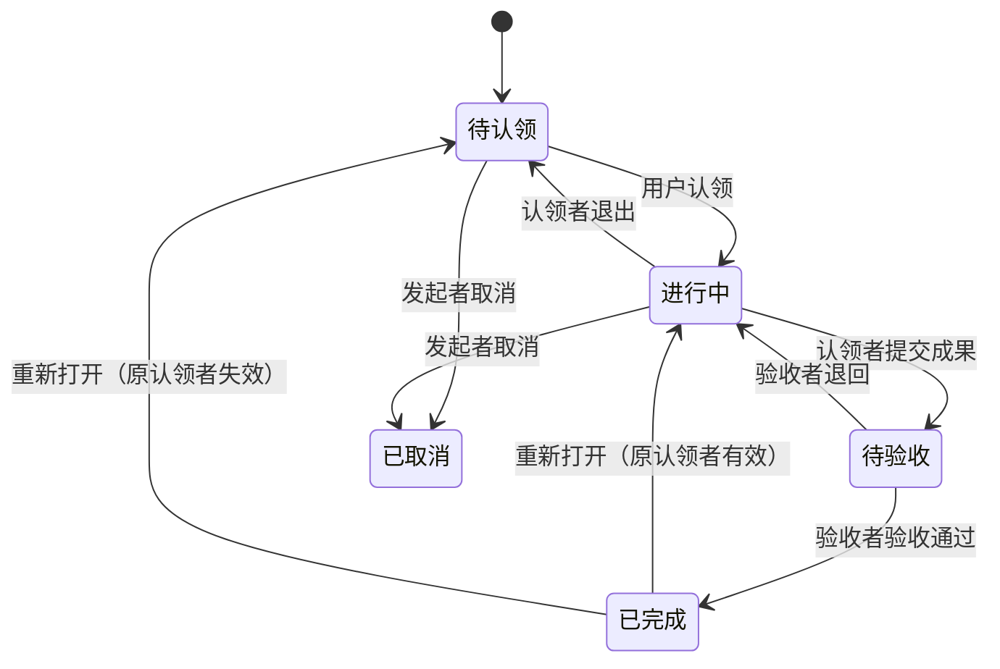

下面给出一个适用于**小型团队内部协作**的 MVP 方案：用户可以发布 Mission、认领未分配的 Mission，并将其拆成可独立认领的子 Mission。

核心原则是：**每个 Mission 都是完整的任务单元；父子关系表达拆分关系，每个节点分别保存内容、发起者、认领者和状态。**

**1. 数据模型**

Mission 可以采用以下结构：

| 字段 | 类型 | 含义 |
|---|---|---|
| `id` | UUID | 唯一标识 |
| `title` | string | 标题 |
| `content` | Markdown | 背景、目标、要求 |
| `acceptance_criteria` | Markdown | 验收标准 |
| `creator_id` | User ID | 发起者，创建后固定 |
| `assignee_id` | User ID / null | 唯一认领者 |
| `reviewer_id` | User ID / null | 独立验收者；新建默认发起者 |
| `parent_id` | Mission ID / null | 父 Mission；为空表示顶层任务 |
| `type` | enum | `Feature` / `Task` / `Bug`，默认 `Task` |
| `priority` | enum | `P0` / `P1` / `P2` / `P3`，默认 `P2` |
| `milestone_id` | Milestone ID / null | 唯一目标里程碑（排期维度，非父任务） |
| `status` | enum | 当前状态 |
| `current_submission_id` | MissionSubmission ID / null | 当前一轮成果；历史轮次不可覆盖 |
| `version` | integer | 用于检测并发修改 |
| `created_at` / `updated_at` | datetime | 创建、更新时间 |

标签单独保存，使用关联表连接 Mission：

```text
User
Mission
Tag
MissionTag(mission_id, tag_id)
MissionDependency(mission_id, prerequisite_id, created_by_id, created_at)
Milestone(id, name, description, due_date, status, version, created_by_id, created_at, updated_at)
MissionSubmission(id, mission_id, submitted_by_id, submitted_at, description, verification_description, reviewer_id_snapshot, outcome, reviewed_by_id, reviewed_at, review_comment, verified_build_reference_id)
SubmissionSourceReference(id, submission_id, provider, repository, revision, browse_url)
SubmissionBuildReference(id, submission_id, provider, build_id, platform, source_revision, artifact_url, status, verification_note)
MissionEvent(mission_id, actor_id, action, payload, created_at)
MilestoneEvent(milestone_id, actor_id, action, payload, created_at)
Comment(mission_id, author_id, content, created_at, updated_at)
LibraryFile(owner_id, file, original_name, content_type, size, created_at)
```

`MissionEvent` 记录认领、退出、修改目标、提交、验收、依赖、转交与重新打开等操作；`MilestoneEvent` 记录里程碑的创建、修改与状态流转。所有事件与对应业务变更在同一事务内写入，包含实际操作者、动作、原因与必要前后值。

`MissionDependency` 表示「`mission` 依赖 `prerequisite`」：`prerequisite` 必须先完成，依赖它的 `mission` 才能提交与验收通过。唯一约束禁止重复 `(mission_id, prerequisite_id)` 与自依赖；依赖方向与父子关系是两种不同关系，分别建模（详见第 8 节）。

`Comment` 是挂在 Mission 下的讨论内容：`content` 与 `Mission.content` 定义完全一致（Markdown 文本，允许为空，不设长度上限）。任何团队成员都可以在可见任务下发表评论，**任意状态都允许评论**（包括已完成、已取消）；只有作者本人可以编辑或删除自己的评论。评论列表按创建时间倒序返回。

`LibraryFile` 是某个用户的素材库文件。文件本体存放在持久化目录 `library/<user_id>/`（文件名使用随机 UUID，不采用上传时的名字，避免冲突与路径穿越），数据库保存归属、原始文件名、内容类型与大小：

| 字段 | 类型 | 含义 |
|---|---|---|
| `id` | UUID | 唯一标识，也是下载 URL 中的 id |
| `owner_id` | User ID | 文件所有者，文件按用户隔离存放 |
| `file` | File | 存储路径 `library/<owner_id>/<uuid><ext>` |
| `original_name` | string | 上传时的文件名，仅用于展示 |
| `content_type` | string | 由扩展名白名单推导，不信任客户端 |
| `size` | integer | 字节数 |
| `created_at` | datetime | 上传时间 |

素材的读取对所有登录成员开放（经授权下载，见第 7 节），但 **Markdown 只能引用作者自己的素材或外链 URL**。删除仅限所有者本人。

用户体系（`accounts.User`，继承 `AbstractUser`）保存团队成员，其中 `is_staff` 标记管理员（可访问管理后台）。**用户注册不直接创建用户**，而是先写入注册申请表：

| 字段 | 类型 | 含义 |
|---|---|---|
| `id` | UUID | 唯一标识 |
| `username` | string | 期望的登录名 |
| `email` | string | 邮箱，可空 |
| `display_name` | string | 姓名，可空；审批通过后写入用户 `first_name` |
| `password_hash` | string | 提交时立即哈希的密码，绝不保存明文 |
| `message` | Markdown | 申请人留言，可空 |
| `status` | enum | `Pending` / `Approved` / `Rejected` |
| `review_note` | string | 拒绝原因等审批意见，可空 |
| `reviewed_by` | User ID / null | 审批的管理员 |
| `reviewed_at` | datetime / null | 审批时间 |
| `created_at` | datetime | 提交时间 |

待审批的注册申请**不写入** `auth_user`：未通过的用户名不会被占用，也不会出现在成员列表中；只有管理员批准时才创建（激活）用户。同一用户名最多允许一条 `Pending` 申请（数据库唯一约束）。

**标签属于当前 Mission，不自动继承。** 查询时可以提供“包含匹配任务的所有子任务”选项，避免标签继承导致分类含义混乱。

多标签查询为 **AND** 语义：重复 `tag` 参数（`?tag=Unity&tag=Gameplay`）或逗号写法（`?tag=Unity,Gameplay`）都表示“任务需同时含有全部标签”，任一标签不匹配则结果为空。

**2. 生命周期**



对应枚举：

```csharp
Open, InProgress, Submitted, Done, Cancelled
```

状态与认领者之间有固定约束：

- `Open`：认领者为空。
- `InProgress`、`Submitted`、`Done`：认领者非空。
- `Cancelled`：保留取消时的认领者，便于追踪历史。

验收由任务的 **验收者（`reviewer`）或管理员**执行，而不是固定为发起者；新建任务时验收者默认等于发起者，但可以指定为他人。默认仍允许认领者与验收者是同一个人，独立验收表示角色可以分开，不强制双人审核。

已完成任务可通过 `reopen` 动作重新打开（仅限 `Done`，必须填写原因）：原认领者仍是有效成员时恢复 `InProgress`，否则清空认领者恢复 `Open`；历史提交与验收记录全部保留，`current_submission_id` 清空。若存在已完成的祖先任务，必须先从最上层向下逐级重新打开祖先，不允许留下「父任务已完成、子任务进行中」的结构。

阻塞是**派生信息**，不新增 `Blocked` 状态：只要存在未完成的前置依赖，任务即显示为阻塞（见第 8 节）。

**3. 父子 Mission 的协作规则**

假设发布一个 Mission：

> **实现角色移动系统**  
> 标签：`Unity`、`Gameplay`  
> 发起者：Alice  
> 认领者：Bob

Bob 将其拆成：

| 子 Mission | 发起者 | 认领者 | 状态 |
|---|---|---|---|
| 实现行走与跳跃 | Bob | Carol | 进行中 |
| 实现 Dash | Bob | 暂无 | 待认领 |
| 编写移动系统测试 | Bob | Dave | 待验收 |

这里 Bob 负责父 Mission 的整体交付，Carol 和 Dave 分别负责具体工作。

建议采用这些规则：

- **认领父任务不会自动认领子任务**；认领子任务也不改变父任务的负责人。
- 父任务的发起者和认领者可以创建子任务；子任务的发起者是实际创建它的用户。
- 全部有效子任务完成后，父任务才允许提交，但**不会自动完成**。Bob 仍需整合成果并交给 Alice 验收。
- 子任务被取消时，必须记录原因；取消任务不阻止父任务提交，父任务发起者在验收时确认是否接受这项范围变化。
- 取消或退出父任务，不自动取消子任务，也不清除子任务的认领者。
- 每个 Mission 最多有一个父任务，禁止形成循环。

这样，任务树既能表达责任，也能保留各层独立的验收关系。

**4. 操作与权限**

| 操作 | 谁可以执行 |
|---|---|
| 发布 Mission | 团队成员 |
| 认领待认领任务 | 团队成员 |
| 编辑目标与验收标准 | 当前任务发起者或管理员 |
| 修改类型 / 优先级 / 验收者 / 目标里程碑 | 当前任务发起者或管理员；限 `Open` / `InProgress` |
| 创建子 Mission | 当前任务发起者或认领者 |
| 添加 / 移除前置依赖 | 当前任务发起者、当前认领者或管理员；限 `Open` / `InProgress` |
| 提交成果与证据 | 当前任务认领者 |
| 退出认领 | 当前任务认领者；限进行中 |
| 验收通过 / 退回 | 当前任务验收者或管理员 |
| 转交验收（仅待验收） | 当前任务发起者或管理员 |
| 重新打开已完成任务 | 当前任务发起者、当前验收者或管理员；仅限 `Done`，须填原因 |
| 取消 | 当前任务发起者或管理员；限待认领或进行中 |
| 创建里程碑 | 团队成员 |
| 编辑里程碑 / 变更里程碑状态 | 里程碑创建者或管理员 |
| 提交注册申请 | 任何人，无需登录 |
| 审批注册申请（通过 / 拒绝） | 管理员（`is_staff`） |
| 查看成员列表 | 管理员（`is_staff`） |
| 查看可验收成员（简要） | 任何团队成员（`GET /api/members/`，仅 id/username/display_name） |
| 发表评论 | 任何团队成员；限可见任务，任意状态 |
| 编辑 / 删除评论 | 评论作者本人 |
| 上传素材 | 团队成员；只能写入自己的 library |
| 查看 / 下载素材 | 任何登录成员（经授权下载） |
| 删除素材 | 素材所有者本人 |
| Markdown 引用素材 | 只能引用自己的素材或外链 URL |

任务进入待验收后，冻结目标和成果内容。需要修改时，先退回进行中；已完成任务保持只读。

所有规则由后端检查，前端根据权限显示按钮。注册申请与成员管理属于 `accounts` 域，普通成员访问 `/api/admin/*` 一律返回 `403`。

**5. 页面与接口**

登录后的首页提供三个入口：

- **任务广场**：默认显示待认领任务，支持多标签（需同时包含）、关键词、发起者、类型、优先级、里程碑与阻塞状态筛选，并支持按优先级排序。筛选项「受阻状态」与「排序方式」的下拉默认显示的是选项文本，鼠标悬停会显示用途说明（受阻判定规则、默认按最新创建在前）。
- **我认领的**：显示自己的进行中、待验收任务。
- **我发布的**：查看任务进展，并处理验收。
- **里程碑（`/milestones`）**：新建与筛选里程碑，查看进度、延期提示与关联任务；里程碑详情可编辑字段并做受控状态流转。
- **素材库（`/library`）**：上传、查看、复制 Markdown 引用、删除自己的文件。任务与评论编辑器提供「插入素材」按钮，可从素材库选择或直接上传，并把引用插入到光标处。
- **管理后台（`/manage`，仅管理员）**：审批注册申请、查看成员列表。由 SPA 自行实现，与 Django Admin（`/admin/`）相互独立。

未登录用户可访问 **注册页（`/register`）** 提交注册申请，等待管理员审批后方可登录。

详情页显示内容、验收标准、任务树、前置依赖、下游任务、未完成子任务、成果与验收历史、讨论区与活动记录。操作按钮随状态变化，例如“认领”“退出”“提交成果”“验收”“转交验收”“重新打开”。所有针对现有对象的写操作在前端携带当前 `expected_version`，遇到 `409` 时提示并刷新数据，不乐观显示成功。

后端使用明确的操作接口，避免允许客户端任意修改状态：

| 接口 | 用途 |
|---|---|
| `POST /missions` | 发布任务（支持 type / priority / reviewer_id / milestone_id） |
| `GET /missions` | 筛选、查询任务（多标签 AND：`?tag=a&tag=b`；新增 type / priority / milestone / blocked 筛选与 priority 排序） |
| `PATCH /missions/{id}` | 编辑允许修改的内容（携带 `expected_version`） |
| `POST /missions/{id}/claim` | 认领 |
| `POST /missions/{id}/release` | 退出 |
| `POST /missions/{id}/submit` | 提交成果（description、验证说明、源码与构建引用） |
| `POST /missions/{id}/review` | 验收通过或退回（`submission_id`、`decision`、`comment`、`verified_build_reference_id`） |
| `POST /missions/{id}/transfer-review` | 待验收时转交验收者 |
| `POST /missions/{id}/reopen` | 重新打开已完成任务（原因 + `expected_version`） |
| `POST /missions/{id}/cancel` | 取消 |
| `GET /missions/{id}/dependencies` | 查询直接前置与直接下游任务（前置项附带 `dependency_id` 以便移除） |
| `POST /missions/{id}/dependencies` | 添加前置依赖 |
| `DELETE /missions/{id}/dependencies/{dependency_id}` | 移除该任务的依赖（`?expected_version=`） |
| `GET /missions/{id}/submissions` | 分页查询各轮成果与证据 |
| `GET /milestones` / `POST /milestones` | 里程碑列表与创建 |
| `GET /milestones/{id}` / `PATCH /milestones/{id}` | 里程碑详情与普通字段编辑（`expected_version`） |
| `POST /milestones/{id}/transition` | 受控里程碑状态流转 |
| `POST /api/auth/register` | 提交注册申请（公开，需 CSRF） |
| `GET /api/members` | 已登录成员均可读取的有效成员列表（id / username / display_name），用于选择验收者 |
| `GET /api/admin/registrations` | 管理员查看注册申请，可按 `status` 筛选 |
| `POST /api/admin/registrations/{id}/approve` | 管理员通过注册申请 |
| `POST /api/admin/registrations/{id}/reject` | 管理员拒绝注册申请，可附原因 |
| `GET /api/admin/users` | 管理员查看成员列表 |
| `GET /missions/{id}/comments` | 分页查看评论（最新在前） |
| `POST /missions/{id}/comments` | 发表评论 |
| `PATCH /comments/{id}` | 编辑自己的评论 |
| `DELETE /comments/{id}` | 删除自己的评论 |
| `POST /api/library/files` | 上传文件到自己的素材库（multipart） |
| `GET /api/library/files` | 分页查看自己的素材 |
| `GET /api/library/files/{id}` | 经授权下载素材（图片内联，其余附件下载） |
| `DELETE /api/library/files/{id}` | 删除自己的素材 |

**认领必须是原子操作。** 例如：

```sql
UPDATE missions
SET assignee_id = :user_id,
    status = 'InProgress',
    version = version + 1
WHERE id = :mission_id
  AND assignee_id IS NULL
  AND status = 'Open';
```

只有更新到一行时才算认领成功；否则返回 `409 Conflict`，提示任务已被认领或状态已变化。操作记录与任务更新应在同一个事务中写入。

**6. 用户注册与管理员审批**

自助注册采用「先申请、后审批」：

1. 未登录用户在 `/register` 提交用户名、密码（可选姓名、邮箱、申请说明）。
2. 后端校验用户名未被现有用户占用、没有重复的待审批申请、密码满足强度要求，然后写入一条 `Pending` 申请；密码在此刻就已哈希，明文不落库。
3. 管理员在 `/manage`（或 Django Admin 的「注册申请」列表）处理：**通过**则创建并激活用户，沿用申请中的用户名、邮箱、姓名与密码哈希；**拒绝**则记录原因，不创建任何用户。
4. 审批前该用户无法登录（凭证不存在，返回 `401`）；审批通过后即可用申请时的密码登录。

审批是状态转换，必须走 `accounts/services.py`（视图与 Django Admin 的 action 都调用它），不能通过直接编辑字段修改状态。并发审批同一申请使用行锁 + 状态校验，只有一个成功，其余返回 `409`（`code=registration_already_reviewed`）。

**7. 素材库与 Markdown 引用规则**

**存储与访问。** 上传的文件按用户隔离存放于 `library/<user_id>/`，是持久化目录而非公开静态目录（生产环境不把 `MEDIA_ROOT` 交给 Caddy）。下载统一走 `GET /api/library/files/{id}/`：任何登录成员都可读取（经授权下载），响应带 `X-Content-Type-Options: nosniff`；图片以 `inline` 返回以便 `` 内联显示，其余类型以 `attachment` 返回。删除只能由所有者本人发起。

**允许的类型与大小。** 白名单扩展名：`png`、`jpg`、`jpeg`、`gif`、`webp`、`pdf`、`zip`、`txt`、`md`；单文件上限 20 MB。内容类型由扩展名推导，不采用客户端声明的类型，避免伪装成 HTML/JS。

**引用规则（写入时校验）。** 所有 Markdown 字段（Mission 的 `content`、`acceptance_criteria`、每轮成果 `MissionSubmission.description`，以及评论 `content`）在写入时必须满足：每个链接/图片目标要么是 **作者自己的素材库链接**（`/api/library/files/<id>/`，且该文件属于作者），要么是 **外链 URL**（`http(s)://` 或协议相对 `//host/...`）。以下一律拒绝并返回 `400`（`code=validation_error`，`field_errors` 指向对应字段）：

- 其他成员的素材库链接，或不存在/非法 id 的素材链接；
- 任意站内路径（如 `/media/...`、`/api/missions/...`）与相对路径；
- `javascript:`、`data:`、`mailto:` 等非 http(s) 协议。

纯文档内锚点（`#section`）允许，因为它不引用任何资源；Markdown 语法与内联 HTML（如 ``、`srcset`）都会被检查，代码块与行内代码会被忽略，避免示例代码误报。校验在服务层完成（`library/references.py` + `missions/services.py`），因此 API 与 Admin 等所有写入口都受同一规则约束。

**8. 扩展：类型、依赖与阻塞、优先级与里程碑、独立验收与重新打开、提交与构建引用**

本节记录在基础 MVP 之上新增的四组能力。它们复用同一 `Mission` 模型、认领与状态机，全部业务写入集中在 `missions/services.py`。

**8.1 类型（F1）**

`Mission.type` 为固定枚举 `Feature` / `Task` / `Bug`，默认 `Task`；三种类型复用同一模型、认领与状态机，不限制父子组合，也不影响「是否完成」的判断。发起者或管理员可在 `Open` / `InProgress` 修改类型并记录 `type_changed` 事件；类型不能只通过标签表达。

**8.2 依赖与派生阻塞（F1）**

`MissionDependency(mission_id, prerequisite_id)` 表示 `mission` 依赖 `prerequisite`，即 `prerequisite` 必须先完成。约束：

- 唯一约束禁止重复 `(mission_id, prerequisite_id)`，并禁止自依赖（数据库 CheckConstraint）。
- 依赖可跨父任务；只能引用同一团队内、操作者可见的任务（本系统所有登录成员可见全部任务）。
- **必须同时检查依赖边与父子边的组合环**：完成顺序图中，子任务默认先于父任务完成，因此隐含 `child -> parent` 边，显式依赖为 `prerequisite -> dependent` 边。新增依赖、调整父节点都在这张合并图上做可达性检查；仅检查依赖表不足以防止死锁。例如「子任务依赖祖先任务」会被拒绝。
- 发起者、当前认领者或管理员可在 `Open` / `InProgress` 添加/移除依赖；`Submitted` / `Done` / `Cancelled` 不允许直接修改依赖，需先退回可编辑状态。

阻塞是派生信息，不新增状态、不维护手工同步字段。API 返回：

| 字段 | 含义 |
|---|---|
| `has_unresolved_prerequisites` | 任一直接前置任务不是 `Done` |
| `is_blocked` | 状态为 `Open` / `InProgress` / `Submitted` 且存在未完成前置任务 |
| `blocking_mission_ids` | 未完成前置任务 ID |
| `unfinished_child_ids` | 尚未完成的有效直接子任务 ID（与依赖阻塞分开表示） |
| `needs_dependency_review` | 已 `Done` 但前置任务不再满足，提示需复核 |

- 前置任务仅在 `Done` 时满足依赖；`Cancelled` 仍阻塞，需显式移除依赖或改前置。
- 父任务的有效子任务排除 `Cancelled` 子任务。
- 阻塞任务仍可认领；提交与验收通过都必须同时检查所有直接前置任务为 `Done` 且所有有效直接子任务为 `Done`，因此阻塞期间禁止提交与验收通过。
- 前置任务重新打开后，下游未完成任务自动显示阻塞；下游已 `Done` 不自动重开，只显示复核提示。不实现递归自动推进。

**8.3 优先级（F2）**

`Mission.priority` 为固定枚举 `P0` / `P1` / `P2` / `P3`，默认 `P2`；`P0` 最紧急。发起者或管理员可在 `Open` / `InProgress` 修改，认领者只能在评论中建议。优先级不代表状态、依赖或截止日期，不触发自动抢占。列表支持按 priority 筛选与排序，相同优先级按创建时间与 ID 稳定排序。

**8.4 里程碑（F2）**

`Milestone` 是排期维度，不是父任务，也不是游戏构建版本：

| 字段 | 含义 |
|---|---|
| `id` | 主键 |
| `name` | 名称 |
| `description` | 交付目标 |
| `due_date` | 可空目标日期（按 `settings.TIME_ZONE` 解释） |
| `status` | `Planned` / `Active` / `Completed` / `Cancelled`，默认 `Planned` |
| `version` | 乐观并发版本号 |
| `created_by_id` | 创建者 |
| `created_at` / `updated_at` | 时间戳 |

- 团队成员可创建；创建者或管理员可编辑字段、变更状态；变更记录 `MilestoneEvent`。
- 受控流转：`Planned -> Active`、`Planned/Active -> Cancelled`、`Active -> Completed`、`Completed/Cancelled -> Active`（恢复需记录原因）。
- 只有 `Planned` / `Active` 的里程碑可接收新的或重新分配的任务（`milestone_not_accepting`）。
- 完成条件：至少一个**有效**（非 `Cancelled`）关联任务，且关联任务全部为 `Done` 或 `Cancelled`；必须由创建者或管理员手动确认，不自动完成。仅含已取消任务或没有任务的里程碑不能完成。
- 不硬删除有任务关联的里程碑，用 `Cancelled` 保留历史。
- 进度 = 直接关联且非 `Cancelled` 的 Mission 中 `Done` 数量 / 有效总数；没有有效任务时为 `null`。`overdue` = 已过目标日期且状态为 `Planned` / `Active`。
- 父子任务分别关联时按不同任务计数；这是任务数比例，不表示工时。
- 已 `Completed` 里程碑中的任务要重新打开时，需先把里程碑恢复为 `Active`；`Cancelled` 同理。

**8.5 独立验收者与成果历史（F3）**

- `Mission.reviewer_id`：新建任务默认发起者；必须是团队有效成员。发起者或管理员可在 `Open` / `InProgress` 修改（记录 `reviewer_changed`）；`Submitted` 状态可通过专用「转交验收」动作修改并记录原因（`review_transferred`），但不得用普通 `PATCH` 修改。
- 验收通过 / 退回只能由当前验收者或管理员执行；发起者只有在同时是验收者或管理员时才能验收。默认允许 `assignee == reviewer`。
- 验收者失效或离开团队（`is_active=False`）时，任务显示 `reviewer_missing`，需重新指定；新增提交必须具有有效验收者（否则 `reviewer_missing`）。
- `MissionSubmission` 记录每一轮成果，永不覆盖旧记录：

| 字段 | 含义 |
|---|---|
| `mission_id` / `submitted_by_id` / `submitted_at` | 所属任务、提交者与时间 |
| `description` | 本轮成果与验证说明（Markdown） |
| `verification_description` | 人工验证步骤与结果；无源码/构建引用时必填 |
| `reviewer_snapshot_id` | 提交时的验收者，仅作历史 |
| `outcome` | `Pending` / `Accepted` / `Rejected` |
| `reviewed_by_id` / `reviewed_at` | 实际验收者与时间（可空） |
| `review_comment` | 验收意见；退回时必填 |
| `verified_build_reference_id` | 验收通过时选定的构建引用 |

- 提交者只能是当前认领者；提交后描述与证据冻结，退回后重新提交产生新记录。
- 验收请求必须针对**当前 Pending 提交**（携带 `submission_id`），过期或不属于当前提交返回 `409`（`submission_conflict`）。
- 提交术语固定为 `description`（不再接受旧字段 `result` 作为别名）；验收决定只接受 `accept` / `reject`。

**8.6 重新打开（F3）**

- 仅限 `Done`；`Cancelled` 不通过 reopen 恢复。发起者、当前验收者或管理员可执行，必须提供非空原因。
- 原认领者仍是有效成员时恢复 `InProgress`；失效时清空认领者恢复 `Open`。
- 保留全部历史提交与验收；清空 `current_submission_id`，后续提交创建新记录；保留 `reviewer`（失效时提示重新指定）。
- 祖先任务已 `Done` 时必须先从上到下逐级重开祖先（`ancestor_done`）；目标里程碑已关闭时必须先恢复里程碑（`milestone_closed`）。
- 不自动重开依赖它的其他任务，按 8.2 展示阻塞或复核提示。失败时不部分改变任务或历史。

**8.7 提交与游戏构建引用（F4）**

`MissionSubmission` 下挂不可变的两类证据，一轮成果可引用多条：

| 对象 | 字段 |
|---|---|
| `SubmissionSourceReference` | id、submission_id、provider（Git / Perforce / UVCS / Other）、repository、revision、browse_url（可空） |
| `SubmissionBuildReference` | id、submission_id、provider、build_id、platform、source_revision（可空）、artifact_url（可空）、status（Unknown / Pending / Succeeded / Failed）、verification_note（可空） |

规则：

- `repository` 与 `revision` 不能为空；`build_id` 与 `platform` 必填。
- `submit` 在同一事务内保存证据并进入 `Submitted`。证据必须满足之一：至少一个源码引用、至少一个构建引用、或清楚的人工验证说明。
- 验收通过时，若附带构建，至少一个构建必须为 `Succeeded`，且验收者须选择所验证的构建（`verified_build_reference_id`），该构建必须属于当前提交；只有失败/等待/未知构建时禁止通过。无构建时该字段为空，验收意见须说明人工验证方式。
- 构建 `status` 表示构建结果，不代表 QA 验收；构建成功不会自动把任务设为 `Done`。
- URL 仅允许 `http(s)`，拒绝带访问凭据的链接；后端不自动访问用户填写的 URL。

**8.8 事务、并发与版本**

- 所有写接口强制要求 `expected_version`（创建对象除外，由服务端初始化版本）：现有动作接口 `claim` / `release` / `submit` / `review` / `transfer-review` / `reopen` / `cancel` / `PATCH`，以及依赖增删、里程碑编辑与流转都校验版本；过期返回 `409`（`version_conflict`）。**这是相对旧接口的破坏性变更**，旧客户端必须携带 `expected_version`；SPA 已同步适配并在冲突时刷新数据。评论没有版本字段，沿用作者权限校验。
- 图结构变更与可能改变完成约束的状态操作统一使用固定键的 PostgreSQL 事务级 advisory lock（单团队一把团队级锁），在读取约束与写入之前获取；只读查询不取锁，锁内不做外部网络请求。提交、验收、依赖、里程碑完成、改里程碑与重新打开的操作相互串行，避免「检查后集合发生变化」。
- Mission 字段、依赖、提交、验收、转交、重新打开均递增所属 Mission 的 `version`；里程碑字段与状态变更递增其 `version`。版本检查与递增同业务写入原子执行。

**8.9 迁移与数据**

- 迁移新增 `type=Task`、`priority=P2`、`reviewer=creator`、`milestone=null`，为任务补充默认值。
- 不保留任何旧版兼容层：`Mission.result` 字段与 `MissionSubmission.is_legacy` 已移除，也不再提供旧数据回填；`submit` 不接受 `result` 别名，`review` 不接受 `approve` 旧决定名。
- 当前进度任务使用 `current_submission_id` 指向最新一轮提交；历史轮次以 `MissionSubmission` 记录，永不覆盖。
- `python manage.py seed_demo` 通过服务层创建一组样板数据（见 `README.md`），用于本地开发与演示；`--reset` 会先清空任务、里程碑、标签与样板用户再重建。

**8.10 前端**

四组功能的前端已适配：任务创建/编辑表单包含类型、优先级、验收者与目标里程碑；列表展示类型/优先级/受阻标识与里程碑，并支持 type / priority / milestone / blocked 筛选与优先级排序；详情页将任务树、前置依赖、下游任务、未完成子任务分开展示，并处理阻塞原因、依赖复核与验收者失效提示；提供成果提交（含源码/构建引用）、按轮次的成果与验收历史、验收构建选择、转交验收与重新打开原因输入；新增里程碑列表与详情页（进度、延期、关联任务、受控流转）；所有写操作携带 `expected_version`，遇到 `409` 刷新数据。前端路由新增 `/milestones` 与 `/milestones/:id`，导航新增「里程碑」。

前端验证命令（`frontend/`）：`npm run type-check`、`npm run test`、`npm run build`。
